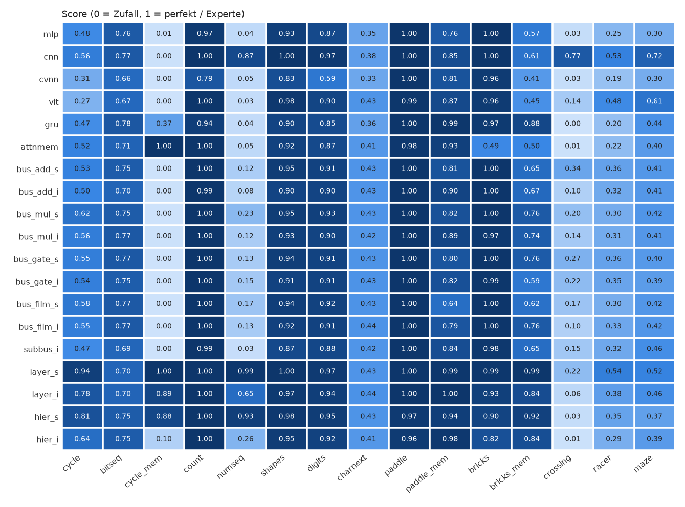

# NetResearch

Eine Forschungsplattform, um Architekturen neuronaler Netze unter **einheitlichem Input und Output**
zu vergleichen. Im Mittelpunkt stehen **modulare Netze**: Busse, Gitter und Hierarchien aus kleinen Modulen,
deren Gewichte entweder geteilt oder individuell sind. Sie treten gegen klassische Architekturen an (MLP, CNN,
CVNN, ViT, GRU, Attention). Langfristig geht es um Netze mit Gedächtnis und um ein **Trainer-Netz**, das schnelles
Lernen ohne Backprop ermöglicht.

* Konzept: [`NetResearch.md`](NetResearch.md)
* Umsetzungsplan der Plattform: [`PLAN.md`](PLAN.md)
* Nächster Forschungsschritt (Trainer-Netz, World-Model, Lernen ohne Backprop): [`PLAN_TRAINER.md`](PLAN_TRAINER.md)
* Aktueller Report: [`results/report.md`](results/report.md)

## Idee

Jede Aufgabe, ob Spiel, Bitmuster, Bild oder Text, wird auf dieselbe Schnittstelle abgebildet:

* **Input:** ein binäres RGB-Bild mit 3×16×16 Pixeln pro Zeitschritt.
* **Output:** 64 Logits, nach Funktion in feste Bereiche geteilt. Ein Ausgabe-Neuron bedeutet so in jeder
  Aufgabe dasselbe.

| Bereich | Slots | Verwendung |
|---|---|---|
| Motorik | 0–7 | Aktionen in Spielen (noop, links, rechts, hoch, runter, …) |
| Klassifikation | 8–17 | Klasse des Bildes |
| Bit-Vorhersage | 18–25 | nächstes Bit / nächste Bitzeile |
| Symbol-Vorhersage | 26–63 | nächstes Zeichen |

Jedes Netz hat dieselbe API `forward(x, state) -> (logits, state)` und etwa 100k Parameter. Damit lassen sich
alle Netze ohne Anpassung gegen alle Aufgaben antreten lassen. Netze mit Zustand, also mit Gedächtnis, laufen
überall mit.

### Aufgaben (15)

| Gruppe | Tasks |
|---|---|
| Patterns | `cycle` (Zeilenmuster fortsetzen), `cycle_mem` (dasselbe, aber nur die aktuelle Zeile sichtbar → Gedächtnis), `count` (Zähler mit zufälligem Start und Schritt), `numseq` (Regel erkennen: arithmetisch oder Fibonacci-artig), `bitseq` (Bitströme) |
| Bilder | `shapes`, `digits` (Test auf ungesehenen Fonts) |
| Text | `charnext` (nächstes Zeichen, Alice im Wunderland) |
| Spiele | `paddle`, `bricks`, `crossing`, `racer`, `maze`, dazu `paddle_mem` und `bricks_mem` ohne Ballspur (brauchen Gedächtnis) |

Test-Muster werden per Hash vom Training getrennt, sodass sie im Training nie vorkommen. Spiele werden
durch Imitation eines Skript-Experten gelernt (DAgger). Ihr Score wird zwischen Zufall (0) und Experte (1)
normiert.

### Modulare Architekturen

* **Bus-Netze:** Module lesen einen gemeinsamen Signal-Bus und schreiben zurück. Die vier Arten der Rückschreibung
  sind add, mul, gate und film.
* **Layer-Gitter:** Module sind in Reihen und Spalten angeordnet. Jedes Modul liest die drei Nachbarn
  darüber und seine seitlichen Nachbarn aus dem vorherigen Zeitschritt. Dadurch hat das Netz eingebautes
  Gedächtnis.
* **Hierarchie-Gitter:** Module sitzen in einem Schachbrettmuster und haben auch Verbindungen nach oben.
  Diese laufen über den vorherigen Zeitschritt, das Netz ist also rekurrent.
* Jede dieser Architekturen gibt es in drei Varianten:
  * `_s`: ein **geteiltes** Modul an allen Positionen.
  * `_i`: **individuelle** Module bei gleicher Parameterzahl.
  * `_iw`: individuelle Module mit gleicher Modulbreite wie `_s`, also mit 2,5- bis 19-mal mehr Parametern.

## Erste Ergebnisse (Phase 3, Seed 0, 1500 Updates je Lauf)

Die Werte stammen aus einem einzigen Seed. Für belastbare Aussagen fehlen noch mehrere Seeds.

| Modell | Patterns | Bilder | Text | Spiele | **Gesamt** | Parameter |
|---|---|---|---|---|---|---|
| layer_s | 0.86 | 0.98 | 0.44 | 0.76 | **0.80** | 101k |
| layer_iw | 0.90 | 0.97 | 0.45 | 0.71 | 0.79 | 1879k |
| cnn | 0.55 | 0.98 | 0.38 | 0.78 | 0.70 | 103k |
| layer_i | 0.71 | 0.95 | 0.44 | 0.67 | 0.70 | 97k |
| hier_s | 0.74 | 0.97 | 0.43 | 0.64 | 0.70 | 100k |
| Bus-Varianten | 0.31–0.40 | 0.90–0.94 | 0.43–0.45 | 0.61–0.66 | 0.54–0.59 | 100–281k |
| gru | 0.36 | 0.88 | 0.36 | 0.64 | 0.56 | 100k |
| attnmem | 0.50 | 0.90 | 0.40 | 0.50 | 0.55 | 102k |
| mlp | 0.29 | 0.90 | 0.35 | 0.56 | 0.50 | 100k |
| cvnn | 0.23 | 0.72 | 0.34 | 0.53 | 0.44 | 100k |



**Befunde:**

1. **Geteilte Gewichte helfen in Gitter-Netzen.** layer_s und hier_s schlagen ihre individuellen
   Gegenstücke bei gleicher Parameterzahl deutlich, mit 0.80 zu 0.70 und 0.70 zu 0.57. Sie bleiben gleichauf
   oder vorne, wenn die individuellen Varianten gleich breit sind und 14- bis 19-mal mehr Parameter haben.
   Sie lernen außerdem schneller: Auf 80 % ihres Endwerts kommen sie meist nach 500 statt nach 750 Updates.
   Den größten Vorteil gibt es bei Gedächtnis- und Regelaufgaben. Bei `cycle_mem` steht hier_s bei 0.78,
   hier_i bei 0.06; bei `numseq` stehen sie bei 0.92 und 0.23.
2. **Gradienten zwischen den Positionen eines geteilten Moduls:**
   - **Gitter:** Die Positionen verlangen fast senkrecht zueinander stehende Änderungen; die Cosinus-Ähnlichkeit
     liegt bei etwa 0, und rund 40–50 % der Paare zeigen gegeneinander. Trotzdem lernt das geteilte Modul am
     besten. Es bringt die verschiedenen Rollen offenbar in getrennten Unterräumen unter.
   - **Bus:** Die Positionen wollen fast dasselbe; die Ähnlichkeit liegt bei 0.5–0.7. Ob die Module geteilt sind,
     spielt deshalb kaum eine Rolle.
   - **Wo das Modul geformt wird:** Über 40 % des Gradienten kommen aus der obersten, inputnahen Reihe.
3. **Gedächtnis:** Netze ohne Zustand stehen bei `cycle_mem` exakt auf Zufallsniveau. Gedächtnis zeigen
   layer_s und attnmem (1.00), layer_i (0.89) und hier_s (0.78). Die GRU kommt nur auf 0.34. In den Spielen ohne
   Ballspur fallen die Netze ohne Zustand deutlich zurück.
4. **Hierarchie-Netz:** Es entwickelt erst Gedächtnis, seit das Modul zufällig statt mit Nullen
   initialisiert wird. Die Null-Initialisierung hatte den rekurrenten Pfad stillgelegt.
5. **CNN:** Sie bleibt bei räumlichen Spielen (`crossing`, `maze`) ungeschlagen.

Laufend: **Multi-Task** – ein Netz lernt alle 15 Aufgaben gleichzeitig, ohne Task-Kennung
(`bench --multitask`). Gemessen werden dabei die Scores im Vergleich zum Einzeltraining und die Ähnlichkeit der
Gradienten zwischen den Aufgaben.

## Setup

```
python -m venv .venv
.venv\Scripts\python -m pip install torch --index-url https://download.pytorch.org/whl/cpu
.venv\Scripts\python -m pip install numpy matplotlib pillow pandas pytest
```

## Benutzung

```
# Tests
.venv\Scripts\python -m pytest -q tests

# Benchmark (resumable, Ergebnisse in results/runs.jsonl; ~0.3 GB RAM je Worker)
.venv\Scripts\python -m netresearch.bench --models all --tasks all --seeds 0 --updates 1500 --workers 6
.venv\Scripts\python -m netresearch.bench --models gru hier_s --tasks cycle_mem --seeds 0 1 2

# Multi-Task: ein Modell lernt alle Tasks gleichzeitig (results/multitask.jsonl; ~1 GB RAM je Worker)
.venv\Scripts\python -m netresearch.bench --multitask --models layer_s hier_s cnn --workers 3

# Report -> results/report.md + results/heatmap.png
.venv\Scripts\python -m netresearch.report

# GUI: trainierte Modelle live nebeneinander beobachten (braucht results/checkpoints aus einem Bench-Lauf)
.venv\Scripts\python -m netresearch.gui
```

## Struktur

| Pfad | Inhalt |
|---|---|
| `netresearch/spec.py` | einheitliche Schnittstelle, Ausgabebereiche |
| `netresearch/tasks/` | Patterns, Bilder, Text, Spiele (mit Skript-Experten) |
| `netresearch/models/` | Baselines, Bus-Netze, Layer- und Hierarchie-Gitter, Parameter-Matching |
| `netresearch/train.py` | Training (überwacht, DAgger), Einzel- und Multi-Task, Lernkurven |
| `netresearch/analysis.py` | Gradienten-Analyse für geteilte Module und zwischen Tasks |
| `netresearch/bench.py`, `report.py`, `gui.py` | Benchmark, Report, Beobachtungs-GUI |
| `results/phase1/`, `results/phase2/` | archivierte Ergebnisse früherer Phasen |

## Erweitern

* **Neues Modell:** Eine Klasse mit `init_state(B)` und `forward(x, state) -> (logits[B,64], state)` anlegen
  (siehe `netresearch/models/basic.py`) und in `MODELS`/`MODEL_ORDER` in `netresearch/models/__init__.py`
  eintragen. Ein Konstruktor mit `width`-Argument genügt, das Parameter-Matching geschieht automatisch.
* **Neuer Task:** `SupervisedTask.sample()` beziehungsweise ein `Game` mit `reset/step/render/expert`
  implementieren und in `netresearch/tasks/registry.py` registrieren.

## Daten

* `data/alice.txt`: „Alice's Adventures in Wonderland“, Project Gutenberg (gemeinfrei).
* `data/digits.npz` wird beim ersten Start aus den Windows-System-Fonts erzeugt. Test-Fonts sind Georgia,
  Trebuchet, Constantia und Segoe Print.
