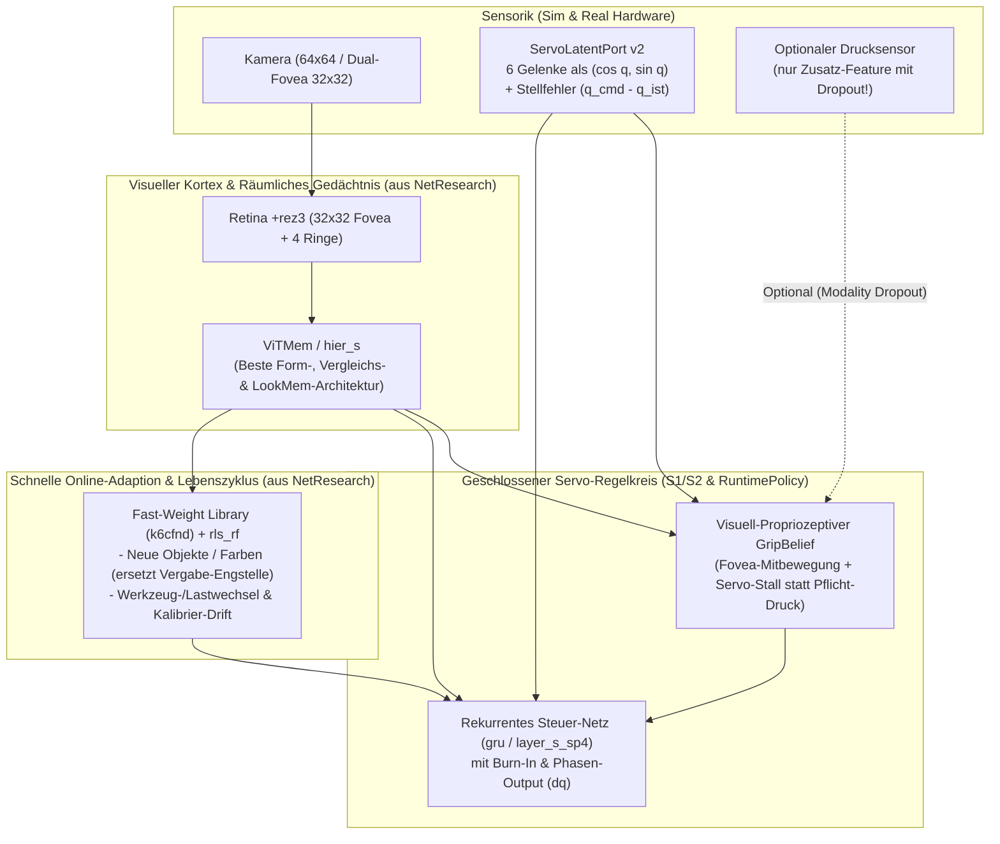

# Projekt-Review: NetResearch & Brücke zu `rdf_thalamus_sml`

**Datum:** 13.11.2026  
**Fokus:** Architektur-Evaluation in `NetResearch`, methodische/technische Analyse, Kritik der Drucksensor-Kopplung und Integrations-Roadmap für die Steuerung des simulierten (MuJoCo) und später physischen Roboterarms in `rdf_thalamus_sml`.

---

## 1. Gesamteindruck & Stärken des Projekts

`NetResearch` ist als experimenteller Architektur-Baukasten außergewöhnlich sauber aufgesetzt:

1. **Strikte Schnittstellen-Disziplin ([netresearch/spec.py](file:///C:/Users/thomas/Projekte/NetResearch/netresearch/spec.py#L1-L40)):**  
   Alle Modelle teilen sich denselben Input-Vertrag `(B, 3, 16, 16)` (bzw. erweiterbar über den Retina-Port `+retN`/`+rezN` auf `(B, 3, 64, 64)`) und denselben 64-Logit-Output-Vertrag (`motor` 0..7, `classify` 8..17, `bits` 18..25, `symbol` 26..63). Dadurch lassen sich über 20 Architekturen ohne Task-spezifische Wrapper fair gegeneinander testen.
2. **Automatische Parameter-Normierung ([netresearch/models/__init__.py](file:///C:/Users/thomas/Projekte/NetResearch/netresearch/models/__init__.py#L116-L132)):**  
   `matched_width()` normiert jede Architektur per Binärsuche automatisch auf ~100k (bzw. `@200k`, `@400k`) trainierbare Parameter.
3. **Wissenschaftliche Buchführung ([LOGBUCH.md](file:///C:/Users/thomas/Projekte/NetResearch/LOGBUCH.md), [STAND.md](file:///C:/Users/thomas/Projekte/NetResearch/STAND.md), [AGENDA.md](file:///C:/Users/thomas/Projekte/NetResearch/AGENDA.md)):**  
   Vorab-Hypothesen, blinde Vorhersage-Tests ([scripts/forecast.py](file:///C:/Users/thomas/Projekte/NetResearch/scripts/forecast.py)), systematische Ablationen und das explizite Dokumentieren gescheiterter Ideen (z. B. `dfa`, `selfmod`, ungedämpfte Hebb-Spuren) verhindern Confirmation Bias.
4. **Herausragendes Ergebnis bei schneller Adaption ([netresearch/library.py](file:///C:/Users/thomas/Projekte/NetResearch/netresearch/library.py), [netresearch/fastweights.py](file:///C:/Users/thomas/Projekte/NetResearch/netresearch/fastweights.py)):**  
   Die Kombination aus **Random-Feature RLS (`rls_rf`)** und der **Fast-Weight-Bibliothek (`k6cfnd`)** löst das Continual-Learning-/Mode-Switching-Problem unter starkem Rauschen, unangekündigten Wechseln und gradueller Drift (0.916 auf 6 Modi, 0.879 bei Drift) nahezu auf Orakel-Niveau – ein Baustein, der direkt ein Kernproblem in `rdf_thalamus_sml` adressiert.

---

## 2. Kritikpunkt: Der Drucksensor als Pflicht-Input statt als optionales Feature

> **Anforderung:** Der Drucksensor (`sim.grip_pressure("left")`, `state[11:13]`) darf **nur optional als Feature** verwendet werden, da ein späterer physischer Roboterarm entweder gar keinen Taktsensor besitzt, dieser stark driftet oder bei bestimmten Griffgeometrien (z. B. „Nagel-Griff" an der Fingerspitze, vgl. [griff-glaube-und-tastsinn.md](file:///C:/Users/thomas/Projekte/rdf_thalamus_sml/wiki/befunde/griff-glaube-und-tastsinn.md)) trotz stabilem Halt `0.0 N` liefert.

Obwohl in [hoehe-ertasten.md](file:///C:/Users/thomas/Projekte/rdf_thalamus_sml/wiki/mechanismen/hoehe-ertasten.md#L1-L25) bereits die Leitlinie *„KAMERA STATT TASTEN (2026-09-24)"* formuliert wurde und `NetResearch` selbst vorbildlich rein visuell arbeitet ([export_netresearch.py](file:///C:/Users/thomas/Projekte/rdf_thalamus_sml/src/pc_cvnn/export_netresearch.py)), ist der Drucksensor im Zielprojekt `rdf_thalamus_sml` (`act16`/`act23`) aktuell **tief und nicht-optional in den State, die Policy und sämtliche Aspekt-Köpfe einbetoniert**:

### 2.1 Direkter Policy-Input in `policy_state` (`state[11:13]`)
- In [pc_act16.py](file:///C:/Users/thomas/Projekte/rdf_thalamus_sml/src/pc_cvnn/pc_act16.py#L1146-L1148) wird an jeden `policy_state`-Vektor `[1.0 if press >= 0 else 0.0, max(press, 0.0)]` (`[druck_gueltig, druck_N]`) angehängt.
- In [runtime_policy.py](file:///C:/Users/thomas/Projekte/rdf_thalamus_sml/src/pc_cvnn/arm_modules/runtime_policy.py#L75-L105) migriert `RuntimePolicyModule` alte 11-Dim-Vektoren zwar mit `[0.0, 0.0]`, aber **alle in MuJoCo gesammelten Episoden schreiben permanent `druck_gueltig = 1.0`**.
- Das `RuntimePolicy`-MLP lernt dadurch eine starke Gewichtung auf `state[12]` (`druck_N`). Fällt der Drucksensor am realen Arm weg (`state[11:13] = [0.0, 0.0]`), bewegt sich das MLP Out-of-Distribution, weil im Training niemals Sensor-Dropout (`druck_gueltig = 0`) geübt wurde.

### 2.2 Verdeckter Folgeschaden: `ACT16_OBS_STATE=1` zerstört `state[3:6]` (Würfel-Koordinaten) ohne Drucksensor!
Noch gravierender als `state[11:13]` selbst ist ein verdeckter Seiteneffekt in [pc_act16.py](file:///C:/Users/thomas/Projekte/rdf_thalamus_sml/src/pc_cvnn/pc_act16.py#L166) und [pc_act16.py](file:///C:/Users/thomas/Projekte/rdf_thalamus_sml/src/pc_cvnn/pc_act16.py#L1105-L1138):
- `OBS_STATE` ist **standardmäßig aktiv (`ACT16_OBS_STATE = 1`)**.
- Darin werden die im Policy-State übergebenen Objektkoordinaten `state[3:6]` (`c_st, cz_st`) nicht aus der Kamera während des Tragens bestimmt, sondern über folgende Weiche:
  ```python
  _holding = press > 0.3 and _j5q < J5_CLOSED_TH
  if _holding:
      self._obs_cube_xy = hand_xy.copy()
      self._obs_cube_z = float(hand_z)
  ```
- **Konsequenz:** Ist kein Drucksensor vorhanden (`press <= 0.3`) oder hält der Greifer das Objekt formschlüssig ohne Fingerdruck (`press == 0.0`), ist `_holding` **immer `False`**! Die Objektkoordinaten `state[3:6]` wandern beim Heben und Tragen **nicht** mit der Hand mit, sondern bleiben auf der alten Tischposition eingefroren. Selbst ein Netz, das `state[11:13]` komplett ignoriert, erhält dadurch ohne Drucksensor korrumpierte Inputs auf `state[3:6]`!

### 2.3 Harte Verdrahtung in allen Aspekt-Köpfen (`arm_modules/*_kopf.py`)
Sämtliche modularen Köpfe in `act23` setzen den Drucksensor als Pflicht-Bedingung oder primäres Feature voraus:
1. **`LoslassKopf` ([loslass_kopf.py](file:///C:/Users/thomas/Projekte/rdf_thalamus_sml/src/pc_cvnn/arm_modules/loslass_kopf.py#L41-L56)):**  
   Prüft in `haelt(s)` hart `float(s[12]) > 0.3` und filtert Trainingsdaten in `lernen()` mit `m = (X[:, 12] > 0.3) & (X[:, 8] < 0.27)`. Ohne Drucksensor wird `LoslassKopf` **niemals aktiv** und **niemals trainiert**.
2. **`FehlgriffKopf` ([fehlgriff_kopf.py](file:///C:/Users/thomas/Projekte/rdf_thalamus_sml/src/pc_cvnn/arm_modules/fehlgriff_kopf.py#L24-L53), per Default EIN):**  
   Nimmt `s[12]` (Fingerdruck) als erstes Feature (`aspekte`) und lernt laut [fehlgriff-kopf.md](file:///C:/Users/thomas/Projekte/rdf_thalamus_sml/wiki/befunde/fehlgriff-kopf.md#L68-L74) im Wesentlichen die Schwelle `druck == 0 -> Fehlgriff!`. Ohne Drucksensor meldet `FehlgriffKopf` bei **jedem** geschlossenen Heben sofort einen Fehlgriff und reißt die Klaue mitten in der Luft wieder auf!
3. **`AufgebenKopf` ([aufgeben_kopf.py](file:///C:/Users/thomas/Projekte/rdf_thalamus_sml/src/pc_cvnn/arm_modules/aufgeben_kopf.py#L34-L39)):**  
   Berechnet `haelt = 1.0 if (len(s) > 12 and s[12] > 0.3 and s[8] < 0.27) else 0.0` und übergibt `float(s[12])` direkt als Feature.
4. **`HaltKopf` & `HaltSehenKopf` ([halt_kopf.py](file:///C:/Users/thomas/Projekte/rdf_thalamus_sml/src/pc_cvnn/arm_modules/halt_kopf.py#L27-L103)) sowie `GriffKopf` ([griff_kopf.py](file:///C:/Users/thomas/Projekte/rdf_thalamus_sml/src/pc_cvnn/arm_modules/griff_kopf.py#L20)):**  
   Nutzen `s[12]`, `ohne` (Schritte ohne Druck) bzw. `pmax` als zentrale Eingangsgrößen oder Trainings-Labels.
5. **Episoden-Ende & WorldModel-Credit-Assignment ([pc_act16.py](file:///C:/Users/thomas/Projekte/rdf_thalamus_sml/src/pc_cvnn/pc_act16.py#L858-L895), [pc_act23.py](file:///C:/Users/thomas/Projekte/rdf_thalamus_sml/src/pc_cvnn/pc_act23.py#L8718-L8743)):**  
   Sowohl `ENDE_SELBST` (`_p_e = float(sim.grip_pressure("left")) > 0.3`) als auch `ACT23_GRIPLABEL` (Default `1`) stützen ihre Erfolgs-/Misserfolgs-Bewertung direkt auf den Drucksensor.

### 2.4 Lösungsvorschlag: Drucksensor als echtes optionales Feature kapseln
1. **Visuell/Propriozeptive Halte-Erkennung statt `press > 0.3`:**  
   Ob ein Objekt gehalten wird, lässt sich ohne Taktsensor aus zwei Quellen bestimmen:
   - **Visuell (Hand-Fovea / Kamera):** Bewegt sich die Objektfarbe/Objektkontur in der Fovea synchron mit der Handbewegung mit? (Genau das Prinzip aus `D0b` Eigenbewegung).
   - **Propriozeptiv (Servos):** Bleibt der Greifer-Gelenkwinkel `j5_q` trotz Schließbefehl (`j5_cmd < j5_q`) bei einem Öffnungswinkel `> j5_closed_empty` stehen (*Stall-Detektion* über Positionsfehler `|q_cmd - q_ist|`), klemmt ein physisches Objekt zwischen den Fingern – ganz ohne separaten Drucksensor!
2. **Modality Dropout beim Training (`druck_gueltig`):**  
   Wenn `state[11:13]` erhalten bleibt, muss im Training von `RuntimePolicy` und den Aspekt-Köpfen in z. B. 50 % der Episoden `state[11:13] = [0.0, 0.0]` maskiert werden (*Sensor Dropout*). Nur dann lernt das Netz, den Drucksensor als **optionalen Zusatzhinweis** zu nutzen, ohne bei dessen Ausfall zu versagen.
3. **Eigener Feature-Port statt harter `if s[12] > 0.3`-Gates:**  
   Alle harten `s[12] > 0.3`-Weichen in `loslass_kopf.py`, `aufgeben_kopf.py` und `pc_act16.py` sollten durch ein gelerntes oder multimodales `GripBelief`-Signal ersetzt werden, das rein visuell/propriozeptiv funktioniert und Taktdruck nur (falls `druck_gueltig == 1`) als Bayes'sches Update einspeist.

---

## 3. Gefundene Fehler, Schwachstellen & Technische Schulden in `NetResearch`

Bei der Code-Durchsicht von `NetResearch` sind mehrere konkrete Fehler und methodische Engpässe aufgefallen, die einige rätselhafte Befunde aus `LOGBUCH.md` und `AGENDA.md` direkt erklären:

### 3.1 Bug: `ControlLearner._sample` löscht das Gedächtnis mitten in der Episode (`res[0] = 1.0`)
- **Fundstelle:** [netresearch/train.py](file:///C:/Users/thomas/Projekte/NetResearch/netresearch/train.py#L254-L265)
- **Problem:** In `ControlLearner.collect()` laufen Episoden über viele Chunks der Länge `T=16` (bzw. `32`) weiter; `self.state` wird korrekt über Chunk-Grenzen hinweg fortgeführt und `res` ist nur bei echtem Episoden-Reset `1.0`.  
  Beim Sampling aus dem Replay-Puffer überschreibt `_sample()` jedoch **immer** den ersten Zeitschritt jedes gezogenen 16er-Fensters:
  ```python
  res = self.buf_res[idx, s].clone()
  res[0] = 1.0
  ```
  In `run_sequence()` ([netresearch/train.py](file:///C:/Users/thomas/Projekte/NetResearch/netresearch/train.py#L51-L59)) führt `res[0] == 1.0` dazu, dass der rekurrente State (`state`) zu Beginn **jedes** Trainings-Chunks auf `init_state` (Nullen) zurückgesetzt wird – selbst wenn das Fenster mitten aus Schritt 80 einer laufenden Episode stammt!  
  In `evaluate_control()` ([netresearch/train.py](file:///C:/Users/thomas/Projekte/NetResearch/netresearch/train.py#L312-L336)) läuft die Episode dagegen ohne Reset über 60–400 Schritte durch.
- **Auswirkung:** Das erklärt direkt den offenen Punkt in [AGENDA.md](file:///C:/Users/thomas/Projekte/NetResearch/AGENDA.md#L23) (*„Warum ist `layer_i_sp4` in Spielen so unruhig (0.58 -> 0.42 -> 0.65)?"*) sowie das Scheitern fast aller Gedächtnismodelle auf `bricks_mem` und `grid_scroll`: Im Training sieht das Netz niemals einen State, der älter als 15 Schritte ist, während es im Eval plötzlich mit hunderten Schritten akkumuliertem State konfrontiert wird.
- **Fix-Vorschlag:** Entweder ein **Burn-In-Fenster** (z. B. 8 Schritte ohne Gradienten vor den 16 Trainingsschritten, R2D2-Stil) nutzen oder den `state` zu Beginn jedes Chunks im Puffer mitspeichern.

### 3.2 Bug: `Fast` (`dfa` / `grad`) ignoriert innere Schichten bei allen Nicht-Shared-Grid-Modellen
- **Fundstelle:** [netresearch/fastweights.py](file:///C:/Users/thomas/Projekte/NetResearch/netresearch/fastweights.py#L121-L131) und [netresearch/fastweights.py](file:///C:/Users/thomas/Projekte/NetResearch/netresearch/fastweights.py#L290-L306)
- **Problem:** In `Fast.__init__` werden Forward-Hooks nur registriert für:
  1. `n == "head" and isinstance(m, nn.Linear)`
  2. `isinstance(m, CellLinear) and m.shared`
  Für `cnn`, `mlp`, `vit`, `gru` oder `layer_i` (`m.shared == False`) wird **keine einzige innere Schicht** gehookt! Wenn man `dfa` oder `grad` auf `cnn` oder `mlp` aufruft, aktualisiert `Fast.step()` stillschweigend nur `head` (identisch zu `delta_head`, nur mit falscher Skalierung), ohne eine Warnung auszugeben.
- **Zusätzlicher Bug in `dfa` ([netresearch/fastweights.py](file:///C:/Users/thomas/Projekte/NetResearch/netresearch/fastweights.py#L299-L301)):**  
  Für `n == "fc2"` in `LayerGrid` wird in `Fast.step` **keine** Aktivierungs-Ableitung multipliziert, aber in `LayerGrid.forward` ([netresearch/models/grid.py](file:///C:/Users/thomas/Projekte/NetResearch/netresearch/models/grid.py#L335-L343)) folgt nach dem Residual `out = out + self.fc2(hid, r)` im nächsten Layer `r+1` erst `norm` und `fc1`. Da `B_fc2` den Fehler `err` direkt auf den Ausgang von `fc2` einzelner Zeilen projiziert, ohne LayerNorm-Skalierung der Folgeschicht zu berücksichtigen, divergiert `dfa` bei größeren Lernraten.

### 3.3 Bug / Einschränkung: `Fast` und `library.py` funktionieren nur für `T == 1`
- **Fundstelle:** [netresearch/fastweights.py](file:///C:/Users/thomas/Projekte/NetResearch/netresearch/fastweights.py#L199-L205), [netresearch/fastweights.py](file:///C:/Users/thomas/Projekte/NetResearch/netresearch/fastweights.py#L258-L261), [netresearch/fastweights.py](file:///C:/Users/thomas/Projekte/NetResearch/netresearch/fastweights.py#L308-L312)
- **Problem:** `_err()`, `_rls()` und `_np3()` indizieren hart `logits[0]`, `b["target"][0]` und `b["mask"][0]`. Bei jeder Sequenzaufgabe mit `T > 1` (wie `recall`, `crossmem`, `robot_lookmem`, `delay`) werden die Zeitschritte `t = 1..T-1` komplett verworfen (und in `robot_lookmem` liegt die Zielmaske überhaupt erst auf dem letzten Frame `t = T-1 = 5`, sodass `b["mask"][0]` komplett `False` ist!).
- **Fix-Vorschlag:** Statt Index `[0]` den letzten maskierten Schritt (oder alle Schritte mit `mask.any(dim=-1)`) verarbeiten.

### 3.4 Methodischer Engpass: Zweierkomplement-Bits (`command_bits`) erzeugen künstliche Hamming-Klippen
- **Fundstelle:** [netresearch/tasks/servo.py](file:///C:/Users/thomas/Projekte/NetResearch/netresearch/tasks/servo.py#L88-L93), [netresearch/tasks/robot.py](file:///C:/Users/thomas/Projekte/NetResearch/netresearch/tasks/robot.py#L55-L60), [netresearch/train.py](file:///C:/Users/thomas/Projekte/NetResearch/netresearch/train.py#L80-L82), [netresearch/train.py](file:///C:/Users/thomas/Projekte/NetResearch/netresearch/train.py#L123-L126)
- **Problem:** Kontinuierliche räumliche Offsets `(dx, dy)` in `[-8..7]` werden in `servo`, `robot_gaze`, `robot_reach` und `robot_find*` als **2×4-Bit Zweierkomplement-Zahlen** (`SL_BITS`) kodiert, mit unabhängigem `binary_cross_entropy_with_logits` trainiert und über **Exakt-Match aller 8 Bits** (`eq.min(-1).values`) bewertet.
- **Drei massive Nachteile für Robotik:**
  1. **Hamming-Klippe bei 0:** Der Übergang von `dx = -1` (`1111` in 4-Bit Zweierkomplement) zu `dx = 0` (`0000`) kippt **alle 4 Bits gleichzeitig** bei nur 1 Pixel Verschiebung! Gerade um den Zielpunkt `dx ≈ 0, dy ≈ 0` (wo ein Servo-Regler am präzisesten sein muss) ist die Zielfunktion maximal unstetig.
  2. **Keine lineare Adaptierbarkeit:** In `servo.py` musste für eine simple Nullpunkt-Verschiebung `(dx + ox)` ein nichtlinearer Random-Feature-Layer (`rls_rf`) bemüht werden, weil ein additiver Offset im Zweierkomplement nichtlineare Bit-Überträge (Carries) über alle 4 Bits auslöst. In einer kontinuierlichen oder Phasen-Darstellung (`[cos, sin]`) ist ein Offset dagegen eine rein lineare Operation!
  3. **Verzerrte Metrik:** Ein Modell, das `dx = -1` statt `dx = 0` vorhersagt (1 Pixel Abweichung), bekommt exakt denselben Score `0.0` wie ein Modell, das um 8 Pixel danebenliegt. Zudem gewichtet der BCE-Loss das LSB (1 Pixel Fehler) exakt gleich stark wie das Vorzeichen-/MSB-Bit (8 Pixel Fehler).

### 3.5 Warum `hier_s@400k` kollabiert (`zero_init=False` & ungedämpfte Rekurrenz)
- **Fundstelle:** [netresearch/models/grid.py](file:///C:/Users/thomas/Projekte/NetResearch/netresearch/models/grid.py#L368-L410) vs. [AGENDA.md](file:///C:/Users/thomas/Projekte/NetResearch/AGENDA.md#L26)
- **Befund:** In `LayerGrid` ([grid.py](file:///C:/Users/thomas/Projekte/NetResearch/netresearch/models/grid.py#L298)) wird `fc2` mit `zero=True` initialisiert, sodass der Residual-Pfad zu Trainingsbeginn eine saubere Identität ist.  
  In `HierGrid` ([grid.py](file:///C:/Users/thomas/Projekte/NetResearch/netresearch/models/grid.py#L369)) steht dagegen `zero_init=False`! Jede der 6 Zeilen addiert `out = out + ip` mit voller Zufallsvarianz, und `orp` wird ohne Normierung als `ils = prev_orp` in die nächste Zeile eingespeist. Bei `@400k` (`width` verdoppelt sich auf ~168) explodiert die Aktivierungsvarianz über die 6 seriellen Zeilen und Sequenzschritte hinweg.
- **Fix-Vorschlag:** `fc2` (oder den Residual-Zweig) in `HierGrid` mit `zero=True` bzw. `1 / sqrt(2 * R)` skalieren und `prev_orp` vor der Übergabe als `ils` durch eine `LayerNorm` führen.

### 3.6 `AllocMemory` (`_am4`) vs. `RecencyMemory` (`_rm4`)
- **Fundstelle:** [netresearch/models/grid.py](file:///C:/Users/thomas/Projekte/NetResearch/netresearch/models/grid.py#L148-L204)
- **Befund:** Wie im Docstring von `RecencyMemory` bereits richtig bemerkt, hat `AllocMemory` keinen Usage-Decay: Nach wenigen Schritten sind alle `U`-Einträge auf `1.0` gesättigt, und `self.tie = [0, 1e-4, 2e-4, 3e-4]` zwingt **jeden weiteren Schreibvorgang hart in Slot 0**. Dass `layer_s_am4` bei `crossmem` (0.87) gewinnt, liegt daran, dass die ersten 3 geschriebenen Symbole aus den ersten 3 Schritten zufällig in den Slots 1–3 eingefroren bleiben, während Slot 0 als Überschreib-Register dient. Für lange Robotik-Episoden (hunderte Schritte) ist `AllocMemory` ohne Decay jedoch unbrauchbar, weil Slots 1–3 nach den ersten Sekunden der Episode nie wieder beschrieben werden können.

### 3.7 Faire Rechenzeit-Bewertung (FLOPs vs. Parameter) & `forecast.py`-Bias
- **Parameter != Compute:** `layer_s` und `hier_s` teilen ihre ~100k Parameter über `32` bzw. `24` Zellen und führen das MLP pro Tick 24–32× aus (~20× mehr FLOPs als `mlp` oder `layer_i`). `esn` ([netresearch/models/basic.py](file:///C:/Users/thomas/Projekte/NetResearch/netresearch/models/basic.py#L238-L270)) versteckt sogar ~1,17 Mio. Gewichte in nicht-trainierbaren Buffern (`W_in`, `W_rec`) und zählt nur den linearen Readout (~100k). Für die Echtzeit-Steuerung in `rdf_thalamus_sml` (50 Hz / 20 ms Ticks in S1, später 250 Hz am realen Arm) sollte in `results/runs.jsonl` neben `params` auch `macs_per_tick` (oder `ms_per_tick`) protokolliert werden.
- **Bug in [scripts/forecast.py](file:///C:/Users/thomas/Projekte/NetResearch/scripts/forecast.py#L43-L45):**  
  `m = r["model"].replace("+cmd", "")` wirft Modelle mit und ohne `+cmd`-Port in denselben Topf, schließt aber gleichzeitig alle `+ret3`/`+rez3`-Läufe hart aus (`if "+" in m: continue`).

---

## 4. Konkrete Änderungsvorschläge & Erweiterungen für `NetResearch`

1. **Neuer Output-Slot `SL_CONT` / `SL_PHASE` statt Zweierkomplement-Bits:**
   - Ersetze (oder ergänze) für `servo` und `robot_*` die 8 Zweierkomplement-Bits durch **kontinuierliche Regression (`tanh` / Smooth-L1)** oder einen **2D-Phasen-/Cos-Sin-Code (`[cos(pi*dx/8), sin(pi*dx/8)]`)** analog zum `ServoLatentPort` in `rdf_thalamus_sml`.
   - Als Evaluationsmetrik für Reich- und Blickaufgaben sollte neben der Trefferquote (`|dx_pred - dx| <= 0.5`) der **mittlere euklidische Fehler in Pixeln/Zellen** berichtet werden.
2. **Dual-Fovea Input (`Hand-Fovea` + `Target-Fovea` + `Gaze-Offset`):**
   - Die zentrale Erkenntnis aus `robot_reach` (Decke bei 0.62) und `robot_shape_edge` (Einbruch außerhalb von Ring 5) ist: **Eine einzelne Fovea mit peripherer Kompression kann nicht gleichzeitig das Zielobjekt UND die entfernte Hand hochauflösend sehen.**
   - **Vorschlag:** Statt das gesamte Kamerabild in eine einzige Retina zu quetschen, bekommt das Netz **zwei 16×16 (oder 32×32) Fovea-Ausschnitte**:
     1. **Target-Fovea** (zentriert auf den aktuellen Blickpunkt $\vec{g}_{\text{target}}$),
     2. **Hand-Fovea** (zentriert auf die aus der Propriozeption/FK bekannte Handposition $\vec{g}_{\text{hand}}$),
     3. plus den relativen Blickvektor $\Delta \vec{g} = \vec{g}_{\text{target}} - \vec{g}_{\text{hand}}$ über den `+cmd`/`+ref`-Port!
   - Damit entfällt die ungenaue Koordinatensubtraktion im komprimierten Randbereich komplett: Beide Foveae arbeiten im hochauflösenden Zentrum, und das Netz muss nur noch die lokale Feinabweichung innerhalb der beiden Foveae verrechnen!
3. **Propriozeptions-Port (`+prop` / Erweiterung von `N_CMD`):**
   - Um Stufe b (geschlossener Regelkreis mit Gelenkwinkeln) in `NetResearch` abzubilden, sollte `spec.py` einen optionalen kontinuierlichen Propriozeptions-Vektor `prop: (B, 12)` (`6 Gelenke × [cos q, sin q]`, kompatibel zu `ServoLatentPort v2` aus `rdf_thalamus_sml`) unterstützen.
4. **Teacher-/Auxiliary-Losses als reguläres Interface (`aux_heads`):**
   - Der Durchbruch bei `robot_reach` (`0.22 -> 0.62` durch `aux`, [netresearch/tasks/robot.py](file:///C:/Users/thomas/Projekte/NetResearch/netresearch/tasks/robot.py#L462-L466)) zeigt, dass explizite Zwischenziele (*Wo ist die Hand? Wo ist das Ziel?*) während des Trainings den Repräsentations-Engpass auflösen, ohne zur Laufzeit (`eval`) Extra-Inputs zu benötigen. Das sollte aus dem Task-Code in `SupervisedLearner` als allgemeiner Mechanismus (`aux_target`, `aux_mask`) verallgemeinert werden.

---

## 5. Ideen & Roadmap für die Integration in `rdf_thalamus_sml` (Sim & Physischer Arm)

Das Fernziel in `rdf_thalamus_sml` ist die Ablösung der handverdrahteten `perceive_all`-Orakel und fragilen Einzel-Heuristiken in `act23` durch lernende Module ([lernendes-netz-statt-pc-cvnn.md](file:///C:/Users/thomas/Projekte/rdf_thalamus_sml/wiki/entscheidungen/lernendes-netz-statt-pc-cvnn.md), [netresearch-bruecke.md](file:///C:/Users/thomas/Projekte/rdf_thalamus_sml/wiki/fragen/netresearch-bruecke.md)). Aus den bisherigen `NetResearch`-Ergebnissen ergibt sich eine klare Aufgabenteilung der besten Architekturen:



### 5.1 Welche `NetResearch`-Architektur gehört wohin in `rdf_thalamus_sml`?

| Modul in `rdf_thalamus_sml` | Aktueller Engpass in `act23` | Empfohlene Architektur aus `NetResearch` | Begründung aus den Messdaten |
| :--- | :--- | :--- | :--- |
| **`VisualCortex` & `ShapeClassifier` (`D0a`/`D0b`)** | `cnn` bricht bei Rand-Objekten und nach Rotation/Skalierung ein; `perceive_all` mogelt noch bei `z`. | **`Retina (+rez3)` + `ViTMem` (oder `hier_s`)** | `+rez3` hebt `robot_shape_edge_f32_big` auf **0.89**; `ViTMem` lernt `robot_reach` (0.62) und `robot_lookmem` (**0.93**) **ohne Curriculum** und schlägt `cnn`/`gru` deutlich. |
| **`ColourOpenSet` & Objekt-Aneignung** | *„Selbst-Aneignung stockt"* ([offene-faeden-act23.md](file:///C:/Users/thomas/Projekte/rdf_thalamus_sml/wiki/fragen/offene-faeden-act23.md#L21-L39)): Vergabe-Engstelle bei neuen Farben/Formen, teure 600-Epochen-Refits. | **`FastLibrary (k6cfnd)` + `rls_rf` ([library.py](file:///C:/Users/thomas/Projekte/NetResearch/netresearch/library.py))** | Die 4 Mechanismen (*Arbeits-Puffer für junge Slots*, *LRU auf bestätigte Nutzung*, *Binomial-Konsistenztest `cfn`*, *Snapshot-Forking bei Drift `d`*) lösen exakt das Open-Set-Lebenszyklus-Problem in Echtzeit (1 Schritt pro Sample statt 600 Epochen!). |
| **`Blick-Netz` (Sakkaden & Raumgedächtnis)** | Nach Kameraschwenk gehen vorher gesehene Objekte verloren oder Koordinaten driften. | **`ViTMem` + `+ref` (`AddressEncoder`)** | Schlägt alle anderen Modelle auf `robot_lookmem` (**0.93**) und kann über Attention-Memory vergangene Blick-Frames direkt mit ihrer Blick-Adresse (`+ref`) abfragen. |
| **Geschlossener Servo-Loop (`S1`/`S2` & `RuntimePolicy`)** | Statisches MLP ohne Zeitgedächtnis für Trägheit/Totzeit; verlässt sich auf `state[12]` (Druck). | **`gru` oder `layer_s_sp4` + `rls_rf`-Kalibrierkopf** | Kompakte Rekurrenz für Geschwindigkeits-/Totzeitschätzung (`delay`: `_sp4` erreicht **0.94**), kombiniert mit einem schnellen `rls_rf`-Readout für Online-Gain-/Offset-Korrektur. |

### 5.2 Spezifische Ideen für den späteren **physischen Roboterarm** (Sim-to-Real)

Ein echter Roboterarm (z. B. SO-100, Koch v1.1, Dynamixel-/Feetech-Servos) unterscheidet sich in vier Punkten fundamental von MuJoCo. `NetResearch` liefert bereits die Werkzeuge, wenn wir sie gezielt darauf ausrichten:

1. **Online-Selbstkalibrierung über `rls_rf` + `FastLibrary` statt exakter Kinematik:**
   - Am realen Arm verschieben sich Kamera-Extrinsik (Kamerahalterung um 2° verbogen), Servo-Nullpunkte, Getriebespiel (Backlash) und Durchbiegung unter Last (schwerer vs. leichter Gegenstand).
   - **Idee:** Das Basis-Steuernetz (`ViTMem` / `hier_s`) bleibt eingefroren (Slow Weights aus Simulation + echten Episoden), während der letzte Layer über **`rls_rf` + `FastLibrary (k6cfnd)`** im geschlossenen Regelkreis aus dem beobachteten Fehler `(Soll-Blickverschiebung vs. Ist-Blickverschiebung der Hand in der Kamera)` online nachgeführt wird.
   - Noch besser: Wenn der Arm ein schweres Objekt greift, erkennt der Konsistenztest (`cfn`) der `FastLibrary` die veränderte Arm-Dynamik automatisch als eigenen Modus („Mit Last" vs. „Leerlauf") und legt per Snapshot-Forking (`d`) einen eigenen Fast-Weight-Slot pro Lastklasse an!
2. **Totzeit- und Latenz-Kompensation (`delay`-Task für Robotik erweitern):**
   - USB-Kameras (30 fps = 33 ms + Pipeline-Verzögerung) und serielle Servo-Busse haben am realen Arm 40–100 ms Totzeit zwischen Bildaufnahme und sichtbarer Bewegung. Ein Regler ohne Gedächtnis seiner eigenen letzten Befehle schwingt sich dabei unweigerlich auf.
   - **Idee:** In `NetResearch` hat der Scratchpad-Bus (`layer_s_sp4`) beim `delay`-Task (0.94) bewiesen, dass er Verzögerungsketten exakt überbrücken kann. Wir sollten in `netresearch/tasks/servo.py` eine **geschlossene Regelkreis-Variante mit variabler Kamera-Totzeit (1–4 Ticks Delay)** und Efferenzkopie (die letzten $K$ gesendeten Motorbefehle im `+cmd`-Port) einbauen.
3. **Propriozeptiver „Tastsinn" ohne Drucksensor (Strom / Schleppfehler $\Delta q = q_{\text{cmd}} - q_{\text{ist}}$):**
   - Selbst billigste serielle Servos melden ihre aktuelle Ist-Position $q_{\text{ist}}$ (und oft Last/Strom). Wenn die Hand auf den Tisch trifft (Höhe ertasten!) oder sich die Finger um einen Würfel schließen, entsteht sofort eine Differenz $\Delta q = q_{\text{cmd}} - q_{\text{ist}}$ zwischen befohlenem und erreichtem Winkel.
   - **Idee:** Wenn wir im `ServoLatentPort` neben `[cos(q_ist), sin(q_ist)]` auch den **Stellfehler $\Delta q = q_{\text{cmd}} - q_{\text{ist}}$** übergeben, kann das Netz sowohl Tischkontakt („Höhe ertasten") als auch erfolgreiches Zufassen („Finger blockieren am Objekt") rein aus den ohnehin vorhandenen Servo-Encodern lernen – **völlig ohne dedizierten Drucksensor**!
4. **Action Chunking / Kurzzeit-Trajektorien im Output:**
   - Statt pro Kamerabild nur einen einzigen Schritt $\Delta q_{t}$ auszugeben (was bei Kamera-Rucklern zu Zittern am realen Arm führt), kann das Netz über die vorhandenen Output-Slots in `spec.py` gleichzeitig $[\Delta q_{t}, \Delta q_{t+1}, \Delta q_{t+2}, \Delta q_{t+3}]$ (4 Schritte im Voraus, analog zu ACT / Action Chunking with Transformers) vorhersagen und zeitlich exponentiell glätten.

---

## 6. Empfohlene nächste Schritte (Priorisierte Checkliste)

1. **`NetResearch` – Kontinuierlicher / Phasen-Output für `servo` & `robot_*`:**  
   Zweierkomplement-Bits (`command_bits`) durch kontinuierliche/Cos-Sin-Ziele + euklidische Fehlermetrik ergänzen, um zu prüfen, wie stark die 0.62-Decke bei `robot_reach` ein reines Artefakt der 4-Bit-Hamming-Klippe war.
2. **`NetResearch` – Bugfixes in `train.py` und `fastweights.py`:**  
   - In `ControlLearner._sample` das harte `res[0] = 1.0` durch gespeicherte Chunk-Startzustände oder ein kurzes Burn-In ersetzen.
   - In `Fast` die `T == 1`-Indexierung (`logits[0]`) auf den letzten maskierten Zeitschritt verallgemeinern und `nn.Linear`/`nn.Conv2d` auch für Nicht-`CellLinear`-Modelle hookbar machen.
   - In `HierGrid` `zero_init=True` für den Residual-Pfad setzen, um den `@400k`-Kollaps zu beheben.
3. **`NetResearch` – Dual-Fovea (`Hand` + `Target`) testen:**  
   `robot_reach` mit zwei Fovea-Ausschnitten (Hand-Fovea + Ziel-Fovea + Differenzvektor in `+cmd`) testen – das dürfte `robot_reach` von ~0.62 in Richtung >0.90 heben.
4. **`rdf_thalamus_sml` – Drucksensor entkoppeln:**  
   - In `pc_act16.py` (`ACT16_OBS_STATE`) die Halte-Bedingung `_holding` von `press > 0.3` lösen (visuelle Mitbewegung / Greifer-Stall $\Delta j_5$).
   - Sensor-Dropout (`druck_gueltig = 0` in 50 % der Trainings-Samples) für `RuntimePolicy` aktivieren und die harten `s[12] > 0.3`-Gates in `loslass_kopf.py`, `fehlgriff_kopf.py` und `aufgeben_kopf.py` durch einen drucksensor-unabhängigen `GripBelief` ersetzen.
5. **Brücke schlagen – `FastLibrary` (`k6cfnd` + `rls_rf`) in `act23` einbauen:**  
   Das in [netresearch/library.py](file:///C:/Users/thomas/Projekte/NetResearch/netresearch/library.py) fertig erprobte Lebenszyklus-Modul als Drop-in-Ersatz für die stockende Klassen-Vergabe (`ColourOpenSet` / `ShapeClassifier`) und für die schnelle Nachkalibrierung der `ServoLatent`-Brücke nach `rdf_thalamus_sml` übernehmen.
