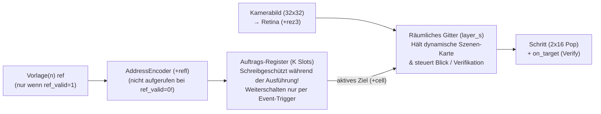

# Projekt-Review: NetResearch & Live-Brücke zu `rdf_thalamus_sml`

**Datum:** 19.11.2026  
**Bezug:** Fortschritt seit [REVIEW-2026-11-13.md](file:///C:/Users/thomas/Projekte/NetResearch/REVIEW-2026-11-13.md) (Commits `6f4480c` bis `29c5f0e` in `NetResearch`, sowie Live-Brücke bis `7534084` in `rdf_thalamus_sml`).  
**Hinweis:** Rein lesende Analyse während laufender Tests – keine Source- oder Ergebnisdateien wurden verändert.

---

## 1. Gesamteindruck & Fortschritts-Bilanz (13.11. → 19.11.2026)

Die Entwicklung der letzten sechs Tage ist methodisch herausragend. Besonders stark sind die konsequente Vorab-Prognose vor jedem Lauf, die Bereitschaft, eigene Hypothesen sauber zu widerlegen (`hier_sz`, `Lage statt Form`, `+pw`), und das mechanistische Probing statt blindem Hyperparameter-Tuning.

### Wichtigste Meilensteine seit dem 13.11.
1. **Durchbruch bei Schritt-Ausgaben (Populations-Code + Schwerpunkt):**  
   Die Umstellung von 8-Bit-Zweierkomplement auf einen 2×16-Populations-Code ($\sigma = 0{,}5$) plus Flächenschwerpunkt hob die Einzelschritt-Formsuche von ~0,63–0,70 auf **0,80–0,81 exakt** (richtiger Körper **0,93–0,97**) und beschleunigte `servo` um den Faktor 4.
2. **Aufbau einer echten Gedächtnis-Leiter in der Blickschleife (1 → 2 → 3 Ziele):**  
   Die Sequenzen `A, B, C` und `A, B, A` (ohne Ausschluss-Shortcut) trennen erstmals scharf zwischen Architekturen und Trainingszuverlässigkeit: `layer_s_sp4` löst bei 24k Updates **6/6 Seeds** (`near_all` 0,71–0,76), `layer_s` nur **3/6** (eingebrochene Läufe 0,21–0,24).
3. **Zwei tiefe mechanistische Erkenntnisse durch Probing:**
   - **Schnittstellen-Falle (`+ref` → `+refl`):** Das frühe Sättigen von `tanh` am Ausgang des `AddressEncoder` war die alleinige Ursache der ungelösten Gitter-Läufe; ohne `tanh` lösen 9/9 Läufe.
   - **Emergente Arbeitsteilung in `layer_s_sp4` ([loop_where_probe.py](file:///C:/Users/thomas/Projekte/NetResearch/scripts/loop_where_probe.py)):** Das Gitter baut eine Szenenkarte mit Besuchsverlauf, der 128-Wert-Notizblock schützt die **Auftragsformen** genau in dem Moment, in dem die ersten Kamerabilder sie aus dem Gitter verdrängen.
4. **Erster Live-Test im MuJoCo-Simulator (`Brücke Stufe b`, 19.11.):**  
   [policy_server.py](file:///C:/Users/thomas/Projekte/NetResearch/scripts/policy_server.py) ↔ [netresearch_live_loop.py](file:///C:/Users/thomas/Projekte/rdf_thalamus_sml/src/pc_cvnn/netresearch_live_loop.py) zeigt eine bitgenaue Übereinstimmung (`static` = Prüfstand ±0,04; Spearman $\rho = 0{,}97$ live) und deckt sofort den wichtigsten Sim-to-Act23-Faktor auf: **Der eigene Arm im Bild kostet 21–28 % (`layer_s`/`sp4`) bzw. 13–18 % (`vitmem`/`attnmem`) – durch reine Ablenkung (`away` = 0,96–1,17× `live`), nicht durch Verdeckung.**
5. **Drucksensor-Leitlinie sauber verankert:**  
   In [drucksensor-entkoppeln.md](file:///C:/Users/thomas/Projekte/rdf_thalamus_sml/wiki/fragen/drucksensor-entkoppeln.md) sind alle Pflicht-Kopplungen in `act16`/`act23` dokumentiert und die strikte Regel *„kein Druck-Eingang in NetResearch"* festgeschrieben.

### Abgleich der Review-Punkte vom 13.11.2026
| Punkt aus Review 13.11. | Status am 19.11. | Bewertung |
| :--- | :--- | :--- |
| **Drucksensor nicht nach NetResearch** | **Umgesetzt / verankert** | Saubere Dokumentation in `rdf_thalamus_sml`; Entkopplung in `act23` steht noch aus. |
| **3.1 Burn-In im Spiele-Training (`--burn`)** | **Geprüft & abgeschlossen** | Half nur `layer_i_sp4` (+0,06/+0,08, Streuung halbiert); Rangfolgen stabil. |
| **3.4 Zweierkomplement → Populations-Code** | **Umgesetzt (großer Gewinn)** | **Noch offen:** `library.py` / `servo`-Adaption und `*_parts` laufen noch in alten Bits! |
| **3.5 `hier_sz` gegen `hier_s@400k`-Kollaps** | **Widerlegt (`0,03`)** | Ursache dafür liegt direkt im Code (siehe Abschnitt 2.5 unten). |
| **3.2 / 3.3 `Fast` (`T > 1`, Nicht-Grid-Hooks)** | **Noch offen** | Relevant, sobald `fastweights`/`library` auf die Blickschleife oder Robot-Tasks kommen. |
| **FLOPs / Latenz neben Parametern loggen** | **Noch offen** | Wichtig für Echtzeit-Regelung in `rdf_thalamus_sml` (50–250 Hz). |

---

## 2. Kritische Code- & Methoden-Befunde (Erklärungen für offene Rätsel & echte Bugs)

### 2.1 Port-Asymmetrie & Bias-Leckage (`ref_enc(0)` + `attach_cmd`) — erklärt direkt das Scheitern von `+pw` (0/12)!

Im Logbuch vom 19.11. ([LOGBUCH.md](file:///C:/Users/thomas/Projekte/NetResearch/LOGBUCH.md#L2688-L2696)) bleibt offen, warum der breite Port-Anfang `+pw` bei `attnmem` und `vitmem` in **0 von 12 Läufen** gelöst hat und warum `attnmem`/`vitmem` insgesamt nur in ~50 % der Seeds lernen. Ein Blick in [models/__init__.py](file:///C:/Users/thomas/Projekte/NetResearch/netresearch/models/__init__.py#L152-L259) und [train.py](file:///C:/Users/thomas/Projekte/NetResearch/netresearch/train.py#L39-L40) deckt **drei konkrete Ursachen im Code** auf:

1. **Versteckter Port-Nachteil im Benchmark (`+cell` vs. `attach_cmd`):**  
   - Die Gitter-Netze (`layer_s`, `layer_s_sp4`, `hier_s`, `layer_s_am4`) laufen mit **`+cell`** ([grid.py](file:///C:/Users/thomas/Projekte/NetResearch/netresearch/models/grid.py#L333-L334)): Der 16-dim Adressvektor geht als **sauber getrennter, unverrauschter Kanal** in jede Gitterzelle, ohne die Bildpixel anzutasten.
   - `attnmem` und `vitmem` laufen dagegen ohne `+cell` über **`attach_cmd`** ([models/__init__.py](file:///C:/Users/thomas/Projekte/NetResearch/netresearch/models/__init__.py#L152-L168)): Der Adressvektor wird per `cmd_in` als 1D-Streifenmuster **direkt auf die RGB-Pixel des Kamerabildes `x` addiert**!
2. **Bias-Leckage während der gesamten Laufphase (`ref == 0` wird trotzdem durch `ref_enc` geschickt):**  
   In den Lauf-Schritten `t = 3..11` übergeben [robot.py](file:///C:/Users/thomas/Projekte/NetResearch/netresearch/tasks/robot.py#L590), [finds_loop_eval.py](file:///C:/Users/thomas/Projekte/NetResearch/scripts/finds_loop_eval.py#L242) und [policy_server.py](file:///C:/Users/thomas/Projekte/NetResearch/scripts/policy_server.py#L84) ein schwarzes Bild `ref = 0`.  
   [train.py](file:///C:/Users/thomas/Projekte/NetResearch/netresearch/train.py#L39-L40) berechnet jedoch bedingungslos:
   ```python
   if ref is not None and hasattr(model, "ref_enc"):
       cmd = model.ref_enc(ref.float())
   ```
   Da `AddressEncoder` drei Schichten mit Bias besitzt (`Conv2d`, `Conv2d`, `Linear`) und `cmd_in` ebenfalls einen Bias hat, ist `cmd_in(ref_enc(0)) != 0`! Auf **jedes echte Kamerabild** während der 9 Lauf-Schritte wird also ein konstantes Stör-Streifenmuster addiert.
3. **Quadratische Verstärkung (`4 × 4 = 16×`) bei `+pw`:**  
   In `scale_port()` ([models/__init__.py](file:///C:/Users/thomas/Projekte/NetResearch/netresearch/models/__init__.py#L251-L258)) werden **beide** linearen Schichten (`ref_enc.net[-2]` **und** `cmd_in`) inklusive ihrer Biases mit `k = 4.0` multipliziert. Das Produkt `cmd_in(ref_enc(ref))` wächst am Start daher um bis zu **Faktor 16** – und überlagert in der Laufphase jedes `[0, 1]`-Kamerabild mit einem massiven zufälligen Rausch-Schleier! Adam muss in den ersten 2000 Updates zwingend `ref_enc` und `cmd_in` herunterdrücken, um überhaupt die Körper im Bild zu sehen. Das bestätigt die Vermutung im Logbuch und zeigt zugleich: Ein reines Vergrößern von `ref_enc` allein reicht nicht – die eigentliche Korrektur ist **(a) eine explizite Maske `ref_valid` (kein `ref_enc(0)` in der Laufphase)** und **(b) ein eigener Token-Port für Transformer statt Pixel-Addition**.

---

### 2.2 Warum `ViTMem` & `AttnMem` im Probe perfekt behalten (0,82–0,86), aber schlecht handeln (0,32–0,45) — Bottleneck + Probe-Artefakt!

Im Logbuch vom 18.11. ([LOGBUCH.md](file:///C:/Users/thomas/Projekte/NetResearch/LOGBUCH.md#L2380-L2385)) zeigt sich ein faszinierendes Paradoxon: Einmal gelernt, halten `vitmem` und `attnmem` die Formen über alle 12 Schritte besser als jedes Gitter-Netz (`B = 0,86`, `C = 0,82`) und haben die stärkste Szenenkarte (`R² = 0,95–0,98`), finden die Ziele aber viel schlechter (`near_all` 0,32–0,45 gegen 0,75 bei `sp4`).

Der Code in [models/basic.py](file:///C:/Users/thomas/Projekte/NetResearch/netresearch/models/basic.py#L173-L242) und [loop_where_probe.py](file:///C:/Users/thomas/Projekte/NetResearch/scripts/loop_where_probe.py#L116-L131) erklärt **beide Seiten dieses Paradoxons exakt**:

1. **Methodischer Probe-Artefakt bei `attnmem` / `vitmem`:**  
   In `AttnMem.forward` ([basic.py](file:///C:/Users/thomas/Projekte/NetResearch/netresearch/models/basic.py#L182)) und `ViTMem.forward` ([basic.py](file:///C:/Users/thomas/Projekte/NetResearch/netresearch/models/basic.py#L240)) ist der zurückgegebene Zustand `state = (new_mem, new_valid)` schlicht der **unveränderte FIFO-Ringpuffer der rohen Frame-Embeddings `[e_{t-15}, ..., e_t]`** – *bevor* die temporalen Transformer-Blöcke (`self.time`) überhaupt darauf rechnen!
   - Wenn `loop_goals_probe.py` und `loop_where_probe.py` eine Ridge-Regression auf `flat(state)` fitten, lesen sie bei `vitmem`/`attnmem` bei `t = 8` schlicht die **original konservierte Kopie von `e_0, e_1, e_2`** (für die Formen) und die **rohen historischen Frame-Embeddings `e_3..e_8`** (für die Karte) aus dem Ringpuffer ab!
   - Das misst bei `vitmem`/`attnmem` also die Qualität des **Eingangs-Archivs `mem`**, nicht – wie bei `layer_s`/`sp4` – den tatsächlich integrierten Rechenzustand nach der temporalen Verarbeitung (`q` nach `self.time`).
2. **Architektur-Flaschenhals in `ViTMem` (Late Fusion durch ein 48-dim CLS-Nadelöhr):**  
   In [basic.py](file:///C:/Users/thomas/Projekte/NetResearch/netresearch/models/basic.py#L230-L239) verdichtet `self.space` alle 16 Bild-Patches der Suchszene (3 Körper × Form × Position) in **ein einziges 48-dim CLS-Token `e = h[:, :1]`**, *bevor* `self.time` auf die gespeicherten Vorlagen zugreifen darf!  
   Bei `layer_s` dagegen liegen die räumlichen Spalten (8 Spalten × `d` = ~544 Werte) direkt vor, und jede Bildspalte hat lokalen Zugriff auf die Zielform aus dem Speicher (`Early Spatial Conditioning`). Dass `vitmem` die 3 Körper + 3 Formen + 3 Positionen *blind* durch 48 Zahlen pressen muss, bevor es weiß, nach welcher Form gesucht wird, ist ein massiver architektonischer Nachteil.

---

### 2.3 Mechanistische Erklärung für den Live-Test (19.11.): Warum verliert `layer_s_sp4` am meisten (23–28 %)?

Im Live-Test ([LOGBUCH.md](file:///C:/Users/thomas/Projekte/NetResearch/LOGBUCH.md#L2481-L2578)) verliert `layer_s_sp4` durch den Arm im Bild relativ am stärksten (`23–28 %`, live 0,55–0,56, unter `layer_s` Seed 0 mit 0,60), während `vitmem` und `attnmem` nur `13–18 %` verlieren – und in `away` (Arm über leerer Tischstelle) ist der Verlust exakt gleich groß (`0,96–1,17×`), während sich das Hängenbleiben auf dem vorigen Körper (`miss_stay_prev`) verdreifacht (`0,03–0,05` → `0,10–0,16`).

**Warum trifft die visuelle Ablenkung gerade `sp4` so hart?**
- In [grid.py](file:///C:/Users/thomas/Projekte/NetResearch/netresearch/models/grid.py#L250-L265) verarbeitet `StripEncoder` das Bild spaltenweise durch `lin` + `tanh`. Ein unbekannter grauer/metallischer Arm im Blickfeld erzeugt über mehrere Spalten hinweg starke OOD-Aktivierungen.
- In `layer_s_sp4` speist jeder Zeitschritt diese OOD-Aktivierungen **direkt in das Schreib-Gate (`mult`, `add`) des Scratchpads** ([grid.py](file:///C:/Users/thomas/Projekte/NetResearch/netresearch/models/grid.py#L341)). Da `sp4` (wie `loop_where_probe.py` bewiesen hat) die Auftragsformen im Scratchpad hält, kann ein einziger unerwarteter Arm-Frame das Schreib-Gate öffnen und die **gespeicherten Auftragsformen oder den Fortschrittszustand korrumpieren** (Folge: Blick bleibt am alten Körper hängen!).
- Bei `vitmem`/`attnmem` sind die Cue-Tokens im FIFO-Puffer `mem` dagegen **physikalisch schreibgeschützt**: Der OOD-Arm-Frame stört nur das aktuelle Frame-Embedding `e_t`, kann aber niemals die gespeicherten Vorlagen A, B, C überschreiben!
- **Erkenntnis für das Zielprojekt:** Ein weicher, gelernte-Gate-Schutz (`sp4`) bricht unter Out-of-Distribution-Wahrnehmungsstörungen ein. Ein echtes **schreibgeschütztes Auftrags-Register** kombiniert die Präzision von `layer_s_sp4` mit der Störfestigkeit von `vitmem`.

---

### 2.4 Gefundene Code-Diskrepanzen und kleinere Bugs

1. **Unterschiedliche `out`-Semantik zwischen Prüfstand und Live-Simulator:**
   - Im Prüfstand ([finds_loop_eval.py](file:///C:/Users/thomas/Projekte/NetResearch/scripts/finds_loop_eval.py#L115-L122)) setzt ein Blickschritt außerhalb des Kamerabilds `out[p, t+1:] = True`; der Lauf bricht ab und zählt für alle restlichen Ziele als `miss`.
   - Im Live-Simulator ([netresearch_live_loop.py](file:///C:/Users/thomas/Projekte/rdf_thalamus_sml/src/pc_cvnn/netresearch_live_loop.py#L174-L177)) fehlt `out`: Verlässt der Schritt das Bild, bleibt `gaze[p]` einfach stehen und das Netz darf weiterlaufen und später noch als `near` zählen. Das sollte angeglichen werden (und kann auch einen Teil der systematisch leicht höheren `static`-Werte in 9 von 12 Netzen erklären).
2. **`pop_variant` trainiert 2×16 Ausgänge mit BCE statt 2×16 Softmax-Cross-Entropy + verwirft Sub-Pixel-Info:**
   - In [servo.py](file:///C:/Users/thomas/Projekte/NetResearch/netresearch/tasks/servo.py#L143) und [train.py](file:///C:/Users/thomas/Projekte/NetResearch/netresearch/train.py#L81) werden die 32 Populations-Ausgänge als `head="bits"` mit unabhängiger `binary_cross_entropy_with_logits` trainiert. Bei $\sigma = 0{,}5$ sind ~85 % der Zielwerte nahe `0,0`, und es fehlt die gegenseitige Normalisierung (Softmax) je Achse.
   - Zudem dekodiert `decode_step()` ([servo.py](file:///C:/Users/thomas/Projekte/NetResearch/netresearch/tasks/servo.py#L118)) nur mit hartem `argmax` statt lokalem Schwerpunkt (Soft-Argmax um das Maximum), womit die kontinuierliche Genauigkeit der Gauß-Glocke verschenkt wird – gerade für die später kontinuierliche Armsteuerung in MuJoCo/Real.
   - Da `pop_variant` die `symbol`-Area (32 von 38 Slots) belegt, kollidiert es jetzt laut [curriculum.py](file:///C:/Users/thomas/Projekte/NetResearch/netresearch/curriculum.py#L63-L65) mit allen `*_parts`-Hilfsaufgaben (`robot_reach_parts`, `robot_finds_parts`), die ebenfalls in `symbol` liegen.
3. **Geteilter mutierbarer `self._rng` in gecachten Task-Instanzen:**  
   In [robot.py](file:///C:/Users/thomas/Projekte/NetResearch/netresearch/tasks/robot.py#L186) (`RobotFindShape`) und [robot.py](file:///C:/Users/thomas/Projekte/NetResearch/netresearch/tasks/robot.py#L511) (`RobotLoopF32`) zieht `make()` die Ansicht (`view 0/1`) aus einem instanzweiten `self._rng` statt aus dem von `sample(..., rng)` übergebenen `rng`. Da `make_task()` ([registry.py](file:///C:/Users/thomas/Projekte/NetResearch/netresearch/tasks/registry.py#L130-L133)) Task-Instanzen global cacht, teilen sich verschiedene Aufrufe im selben Prozess denselben Zufallsstrom.
4. **Performance-Engpass in [netresearch_live_loop.py](file:///C:/Users/thomas/Projekte/rdf_thalamus_sml/src/pc_cvnn/netresearch_live_loop.py#L165-L171):**  
   Für `cond == "live"` und `"away"` rendert die Schleife `sc.render_fine()` für alle 12 Folgen `p = 0..11` separat – auch bei Ziel 1 (wo alle 12 Folgen dieselbe Ruhelage `arm[0]` haben!) und in `away` ab Ziel 2 (wo alle 12 Folgen exakt dieselbe Arm-Pose über `s["free"]` haben!). Ein einfaches Gruppieren nach identischer `arm[p]`-Pose beschleunigt `live` um ~3× und `away` um ~10× (von 75 min auf ~8–25 min)!
5. **Kleinere Härtungsstellen:**
   - [policy_server.py](file:///C:/Users/thomas/Projekte/NetResearch/scripts/policy_server.py#L74) hardcodiert `blank = torch.zeros(1, n, 3, 32, 32)` (bricht bei 16×16-Modellen ohne `+rezN`).
   - [loop_where_probe.py](file:///C:/Users/thomas/Projekte/NetResearch/scripts/loop_where_probe.py#L125) ruft `choice(parts[0][0].shape[1], size=128, replace=False)` auf (crasht für schmale rekurrente Modelle wie `gru`/`lstm` mit State-Dim < 128).

### 2.5 Nachtrag zum widerlegten Review-Punkt 3.5 (`hier_sz` & `hier_s@400k`)
Dass `hier_sz` (`zero_init=True`) bei `cycle_mem` auf 0,03 fiel, ist ein wichtiger Befund – und der Code in [models/grid.py](file:///C:/Users/thomas/Projekte/NetResearch/netresearch/models/grid.py#L441-L442) zeigt exakt warum:
```python
out = out.reshape(B, self.K, 4, self.d)
out = out + torch.stack([torch.zeros_like(ip), ip, torch.zeros_like(ip), torch.zeros_like(ip)], 2)
```
Anders als in `LayerGrid` hat in `HierGrid` **nur `OS` (Slot 1)** einen Residual-Pfad (`+ ip`). Die seitlichen Ausgänge `OLS`, `ORS` und insbesondere der **rekurrente Aufwärtspfad `ORP`** haben **keinen Residual-Pfad**! Mit `zero_init=True` starten `OLS`, `ORS` und `ORP` identisch bei `0` – der gesamte zeitliche Gradient durch `ORP` stirbt am Sattelpunkt.  
Der Einbruch von `hier_s@400k` liegt daher sehr wahrscheinlich an der Kombination aus (a) einer festen Lernrate `lr = 2e-3` für alle Größen (bei 4× Parametern / größerer Breite steigt die effektive Schrittweite) und (b) dem ungedämpften `ORP`-Feedbackpfad ohne Residual-Verbindung über die Zeit. (Ein sauberer Test wäre: nur `OS` klein/null initialisieren oder `lr = 1e-3` bei `@400k`.)

---

## 3. Methodische Risiken auf dem Weg zum Roboter (`act23` & physischer Arm)

### 3.1 Die „Starrer-3-Schritt-Taktgeber"-Falle (`SEG = 3`)
In `robot_loop_two_f32` und `robot_loop_three_f32` ([make_loop_set.py](file:///C:/Users/thomas/Projekte/NetResearch/scripts/make_loop_set.py#L118-L124)) bekommt jedes Ziel **exakt 3 Ticks** (`t=0..2` → A, `t=3..5` → B, `t=6..8` → C), ohne externes Signal für den Zielwechsel.
- Die Netze müssen daher einen **starren 3-Tick-Zähler** in ihrem Zustand mitführen.
- **Im echten Roboter (`act23` und physischer Arm) bricht das sofort:** Wie lange der Arm braucht, um nach Ziel A anzufahren, zu greifen und abzulegen, schwankt zwischen 15 und 150 Ticks (oder scheitert und braucht einen neuen Versuch).
- **Notwendige nächste Stufe:** Variable Verweilzeit pro Ziel (z. B. 2–6 Ticks zufällig im Training) + ein **1-Bit-Ereignis-Signal „nächstes Ziel"** (über den Command-Port). Erst dann lernt das Netz echte ereignisgesteuerte Aufgaben-Umschaltung statt blindem Takte-Zählen!

### 3.2 Warum falsche Körper nicht verlassen werden (`still wrong 0,80–0,98`)
Die Nachmessung vom 19.11. bestätigt sauber, dass kein Netz auf einem falschen Körper umdreht – und Gedächtnisnetze sogar *seltener* weggehen (`0,03–0,18`) als `cnn`/`vit` (`0,26–0,32`).  
Schaut man in [make_loop_set.py](file:///C:/Users/thomas/Projekte/NetResearch/scripts/make_loop_set.py#L43,L88-L94), sieht man zwei strukturelle Ursachen in den Trainingsdaten:
1. Mit `P_OTHER = 0.10` landet der Lehrer nur in 10 % der Schritte auf einem falschen Körper – in Schritt `t=1, 2` eines Ziels sitzt das Auge zu ~85 % bereits auf dem **richtigen** Körper (`step = (0, 0)`). Ein einfacher Prior *„Ich habe Schritt 1 gemacht und ein Körper liegt in der Mitte → bleib stehen `(0, 0)`"* erreicht im Training fast volle Genauigkeit, ohne die Form im Zentrum jemals gegen das Gedächtnis zu prüfen!
2. Es gibt keinen expliziten **Verifizierungs-Ausgang** (*„Passt der Körper im Zentrum zur gespeicherten Vorlage?"*).

**Konkreter Lösungsvorschlag:**  
Im Training für die Blickschleife (a) `P_OTHER` auf `0,30–0,35` erhöhen (oder gezielt 30 % der Sequenzen auf einem falschen Körper starten lassen) und (b) ein **2-Klassen-Hilfsziel `on_target`** (in der `classify`-Area: `1` = richtiger Körper im Zentrum, `0` = falscher/kein Körper) mittrainieren. Dieses `on_target`-Signal ist gleichzeitig genau der **visuelle Kontroll-Kopf** (ohne Drucksensor!), den `rdf_thalamus_sml` braucht, bevor der Arm zum Greifen absenkt!

### 3.3 Arm im Bild (`away` = `live`): Zwei komplementäre Gegenmaßnahmen
Dass der Arm im Bild rein durch visuelle Ablenkung wirkt, ist eine sehr gute Nachricht – es bedeutet, dass das Problem lösbar ist, ohne komplexe 3D-Verdeckungs-Rekonstruktion:
1. **Kurzfristig (Trainingsdaten-Fix, Pflicht vor `act23`):**  
   In [export_netresearch.py](file:///C:/Users/thomas/Projekte/rdf_thalamus_sml/src/pc_cvnn/export_netresearch.py#L339-L340) steht der Arm bei `_place()` immer in `HOME ± 0.25` (außerhalb des Suchbereichs). Ein neuer Export `gazeshapec_arm` sollte in z. B. 50–70 % der Szenen den Arm kinematisch an zufällige Positionen im Arbeitsraum fahren (über Körpern *und* über freien Tischstellen, verschiedene Höhen). Erst danach zeigt der Live-Test das echte Potenzial der Architekturen.
2. **Mittelfristig (Propriozeption / Efferenzkopie für Sim & Real):**  
   Der Roboter kennt seine eigene Gelenkstellung $q$ immer exakt. Wenn das Blick-Netz (oder eine Übersicht-Hälfte) die projizierte Handposition oder die 12-dim Gelenkphasen `[cos q, sin q]` als Port erhält, kann es den eigenen Arm aktiv ausblenden („Das ist meine Hand, kein Zielobjekt") – exakt wie die **Efferenzkopie** im biologischen Gehirn.

---

## 4. Konkrete Architektur- & Forschungs-Ideen

### 4.1 Erster echter Prototyp für „Spezialisierte Module im Verbund": `layer_s_cue` (Geschützter Auftrags-Speicher)
Die beiden stärksten Befunde dieser Woche – (1) in `sp4` entsteht spontan die Trennung `Gitter = Karte`, `Notizblock = Auftragsformen`, und (2) im Live-Test korrumpiert der OOD-Arm genau dieses ungeschützte Scratchpad – weisen direkt auf eine sehr saubere modulare Architektur hin:



- **Kernprinzip:** Statt die Auftragsformen in das vom Kamerabild angesteuerte Scratchpad zu mischen, werden die Cue-Vektoren `AddressEncoder(ref)` in einem **kleinen schreibgeschützten Auftrags-Register** (FIFO/Slot-Liste) abgelegt; das räumliche Gitter (`layer_s`) liest über `+cell` immer den aktuell aktiven Slot (und schaltet per Event-Bit weiter).
- **Hypothese (prüfbar gegen `layer_s_sp4`):**
  1. **100 % Lösequote** auch bei 3, 4 oder 5 Zielen und schon bei 12k Updates (weil B und C beim Losgehen nicht mehr überschrieben werden können).
  2. **Deutlich kleinerer Live-Verlust** bei Arm im Bild (wie `vitmem`, weil die Auftragsformen unantastbar bleiben) bei gleichzeitig voller räumlicher Präzision von `layer_s` (~0,75–0,85 `near_all`).
  3. **Kein starrer 3-Tick-Zähler mehr**, direkt anschlussfähig an die variable Ausführungsdauer in `act23` (und später direkt an ein LLM, das eine Liste von Objekt-Latents ins Auftrags-Register schreibt!).

### 4.2 Fairer Test für Transformer: `ViTMem2` (Token-Port + Early Spatial Conditioning)
Bevor man Transformer-Architekturen (`vitmem`, `attnmem`) gegenüber den Gitter-Netzen als unterlegen einstuft, sollte man die zwei in Abschnitt 2.1/2.2 gefundenen Schnittstellen-Flaschenhälse beheben:
1. **Sauberer Token-Port (mit `ref_valid`-Maske):** Statt `attach_cmd` aufs Bild zu addieren, wird `ref_enc(ref)` bei `ref_valid == 1` direkt als **Token** in den Speicher geschrieben (kein Stör-Bias bei `ref == 0`!).
2. **Spatial Cross-Attention statt 48-dim CLS-Flaschenhals:** Im räumlichen Encoder `self.space` dürfen die 16 Bild-Patches per Cross-Attention direkt auf das Gedächtnis (die gespeicherten Vorlagen) schauen – so kann jeder Patch lokal prüfen, ob seine Form zur gesuchten Vorlage passt (äquivalent zu `+cell` bei den Gittern).

### 4.3 Das „zweite Bein" wieder aktivieren: Schnelle Online-Adaption & Gelenkwinkel-Servo
Während die Blickschleife diese Woche riesige Fortschritte gemacht hat, liegen zwei zentrale Bausteine für den **physischen Roboterarm** noch brach:
1. **`library.py` + `servo` im Populations-Code (und `Sparse-RF-RLS` / Top-K):**  
   Laut [LOGBUCH.md](file:///C:/Users/thomas/Projekte/NetResearch/LOGBUCH.md#L2706) laufen die Anpassungs-Studien noch in alten 8-Bit-Codes. Ein schneller Vergleich `rls_head` vs. `rls_rf` vs. `Sparse-RF-RLS (Top-K)` auf `servo` **im Populations-Code** klärt sofort, ob das frühere Limit (`0,50` bei `offx`/`offy`/`flipx`) ein reines Bit-Übertrag-Artefakt war – und ob spärliche Zufallsmerkmale lokale Nachkalibrierung ohne Überschreiben erlauben.
2. **Der fehlende Rollen-Benchmark „Gelenkwinkel-Servo ohne Drucksensor" ([AGENDA.md](file:///C:/Users/thomas/Projekte/NetResearch/AGENDA.md#L109,L171)):**  
   Für die Agenda *„Spezialisierte Module / Rollen-Benchmarks"* fehlt bisher jede Regler-Stufe für den Arm selbst. Ein kompakter Export aus `rdf_thalamus_sml` (`ServoLatentPort v2`: aktuelle 6 Gelenke als `[cos q, sin q]` + gewünschter Ziel-Bildpunkt / Blickdifferenz → nötige Gelenkänderung $\Delta q$, trainiert aus Selbst-Exploration / „Zappeln" mit Kamera-Rückmeldung, **ohne Drucksensor**) schließt die Lücke zwischen Blicksteuerung und echter Armsteuerung – und erlaubt es, `FastLibrary` direkt an **simulierten Hardware-Störungen** (verbogener Kamerawinkel, Gelenk-Offset, veränderte Servo-Verstärkung, Kamera-Totzeit 1–4 Ticks) zu testen.

---

## 5. Priorisierte Empfehlungen für die nächsten Schritte

1. **Sofort (Quick Wins & Fairness):**
   - `ref_valid`-Maskierung in [train.py](file:///C:/Users/thomas/Projekte/NetResearch/netresearch/train.py#L39-L40) (kein `ref_enc(0)` in der Laufphase) – beseitigt die Bias-Leckage für alle `+refl`-Netze.
   - `out`-Semantik und Render-Caching in [netresearch_live_loop.py](file:///C:/Users/thomas/Projekte/rdf_thalamus_sml/src/pc_cvnn/netresearch_live_loop.py#L165-L177) angleichen (4–10× schnellerer Live-Test, exakte Prüfstand-Parität).
   - `gazeshapec_arm` (Export mit Arm an zufälligen Arbeitsraum-Positionen) erstellen und im Live-Test prüfen, wie weit der 21–28 %-Verlust verschwindet.
2. **Kurzfristig (Wichtigste Architektur-Experimente):**
   - **Auftrags-Register (`layer_s_cue`)** gegen `layer_s_sp4` auf 3 Zielen **mit variabler Schrittzahl + Event-Trigger** und **Arm im Bild** testen (erster echter Test der Hypothese *„Spezialisierte Module im Verbund"*).
   - **Hard-Negative-Blicktraining (`P_OTHER = 0,30`) + `on_target`-Verifizierungs-Kopf** testen, um die `0,80–0,98`-Klebquote auf falschen Körpern zu brechen.
   - **Fairer Transformer-Gegentest (`ViTMem2` mit Token-Port & Spatial Cross-Attention)**, um die Port-Asymmetrie endgültig aufzulösen.
3. **Mittelfristig (Brücke zur Armsteuerung & physischer Hardware):**
   - Anpassungs-Suite (`library.py` / `servo`) auf Populations-Code umstellen + `Sparse-RF-RLS` (Top-K) und Vorwärtsmodell-Gating ohne Teacher prüfen.
   - Rollen-Benchmark **Gelenkwinkel-Servo (ohne Drucksensor, mit Totzeit & Kalibrier-Drift)** als nächstes Modul neben der Blickschleife aufbauen.
