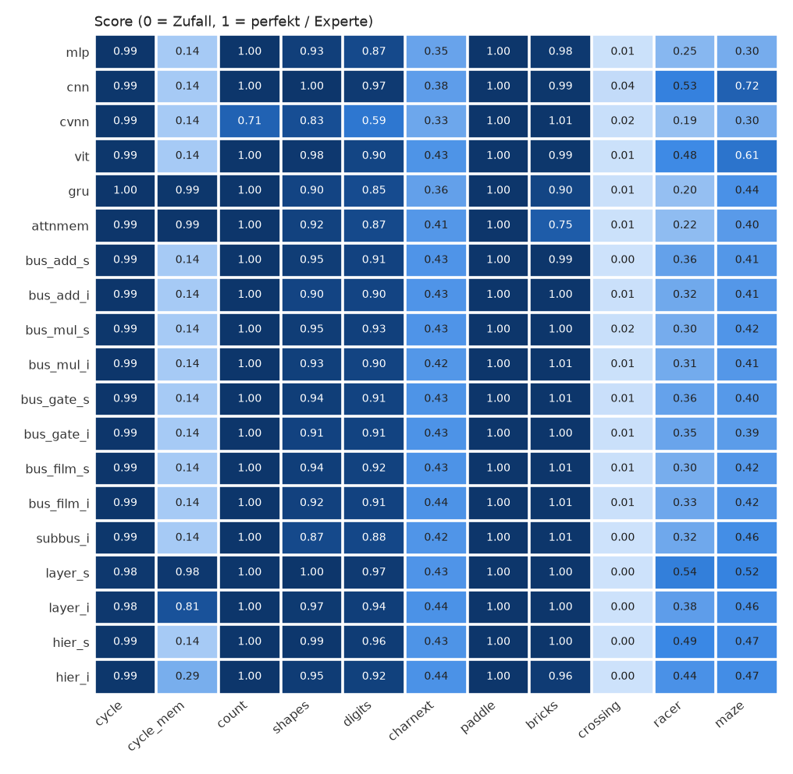

# NetResearch – Benchmark-Report

Läufe: 209 (Seeds [0]), Updates je Lauf: [1500], ~100k Parameter je Modell. Fehlgeschlagene Läufe: 0.

Score: Klassifikation `(acc-chance)/(1-chance)`, Bits: Exact-Match, Spiele `(Return-Random)/(Experte-Random)`. Werte < 0 = schlechter als Zufall.

## Zusammenfassung (Mittel je Task-Gruppe)

| Modell | patterns | image | text | game | gesamt | Ø Rang | Parameter | Trainzeit [min] |
|---|---|---|---|---|---|---|---|---|
| layer_s | 0.99 | 0.98 | 0.43 | 0.61 | 0.76 | 7.68 | 101k | 128.6 |
| layer_i | 0.93 | 0.95 | 0.44 | 0.57 | 0.73 | 8.36 | 97k | 61.9 |
| cnn | 0.71 | 0.98 | 0.38 | 0.65 | 0.70 | 7.45 | 103k | 90.5 |
| gru | 1.00 | 0.88 | 0.36 | 0.51 | 0.70 | 11.50 | 100k | 22.0 |
| attnmem | 1.00 | 0.89 | 0.41 | 0.47 | 0.69 | 12.00 | 102k | 60.8 |
| vit | 0.71 | 0.94 | 0.43 | 0.62 | 0.68 | 9.05 | 96k | 174.5 |
| hier_i | 0.76 | 0.94 | 0.44 | 0.57 | 0.68 | 9.00 | 100k | 79.0 |
| hier_s | 0.71 | 0.97 | 0.43 | 0.59 | 0.68 | 8.36 | 100k | 146.3 |
| bus_gate_s | 0.71 | 0.93 | 0.43 | 0.56 | 0.65 | 8.82 | 100k | 27.5 |
| bus_add_s | 0.71 | 0.93 | 0.43 | 0.55 | 0.65 | 10.27 | 100k | 24.1 |
| bus_mul_s | 0.71 | 0.94 | 0.43 | 0.55 | 0.65 | 9.23 | 100k | 25.4 |
| bus_film_i | 0.71 | 0.92 | 0.44 | 0.55 | 0.65 | 8.27 | 100k | 20.5 |
| bus_film_s | 0.71 | 0.93 | 0.43 | 0.55 | 0.65 | 8.68 | 100k | 26.1 |
| bus_gate_i | 0.71 | 0.91 | 0.43 | 0.55 | 0.65 | 10.00 | 100k | 21.3 |
| bus_mul_i | 0.71 | 0.92 | 0.42 | 0.55 | 0.65 | 10.64 | 100k | 20.7 |
| bus_add_i | 0.71 | 0.90 | 0.43 | 0.55 | 0.65 | 11.27 | 100k | 20.0 |
| subbus_i | 0.71 | 0.87 | 0.42 | 0.56 | 0.65 | 11.64 | 99k | 26.5 |
| mlp | 0.71 | 0.90 | 0.35 | 0.51 | 0.62 | 13.55 | 100k | 16.1 |
| cvnn | 0.62 | 0.71 | 0.33 | 0.50 | 0.56 | 14.23 | 100k | 20.4 |

## Score je Task

| Modell | cycle | cycle_mem | count | shapes | digits | charnext | paddle | bricks | crossing | racer | maze |
|---|---|---|---|---|---|---|---|---|---|---|---|
| mlp | 0.99 | 0.14 | 1.00 | 0.93 | 0.87 | 0.35 | 1.00 | 0.98 | 0.01 | 0.25 | 0.30 |
| cnn | 0.99 | 0.14 | 1.00 | 1.00 | 0.97 | 0.38 | 1.00 | 0.99 | 0.04 | 0.53 | 0.72 |
| cvnn | 0.99 | 0.14 | 0.71 | 0.83 | 0.59 | 0.33 | 1.00 | 1.01 | 0.02 | 0.19 | 0.30 |
| vit | 0.99 | 0.14 | 1.00 | 0.98 | 0.90 | 0.43 | 1.00 | 0.99 | 0.01 | 0.48 | 0.61 |
| gru | 1.00 | 0.99 | 1.00 | 0.90 | 0.85 | 0.36 | 1.00 | 0.90 | 0.01 | 0.20 | 0.44 |
| attnmem | 0.99 | 0.99 | 1.00 | 0.92 | 0.87 | 0.41 | 1.00 | 0.75 | 0.01 | 0.22 | 0.40 |
| bus_add_s | 0.99 | 0.14 | 1.00 | 0.95 | 0.91 | 0.43 | 1.00 | 0.99 | 0.00 | 0.36 | 0.41 |
| bus_add_i | 0.99 | 0.14 | 1.00 | 0.90 | 0.90 | 0.43 | 1.00 | 1.00 | 0.01 | 0.32 | 0.41 |
| bus_mul_s | 0.99 | 0.14 | 1.00 | 0.95 | 0.93 | 0.43 | 1.00 | 1.00 | 0.02 | 0.30 | 0.42 |
| bus_mul_i | 0.99 | 0.14 | 1.00 | 0.93 | 0.90 | 0.42 | 1.00 | 1.01 | 0.01 | 0.31 | 0.41 |
| bus_gate_s | 0.99 | 0.14 | 1.00 | 0.94 | 0.91 | 0.43 | 1.00 | 1.01 | 0.01 | 0.36 | 0.40 |
| bus_gate_i | 0.99 | 0.14 | 1.00 | 0.91 | 0.91 | 0.43 | 1.00 | 1.00 | 0.01 | 0.35 | 0.39 |
| bus_film_s | 0.99 | 0.14 | 1.00 | 0.94 | 0.92 | 0.43 | 1.00 | 1.01 | 0.01 | 0.30 | 0.42 |
| bus_film_i | 0.99 | 0.14 | 1.00 | 0.92 | 0.91 | 0.44 | 1.00 | 1.01 | 0.01 | 0.33 | 0.42 |
| subbus_i | 0.99 | 0.14 | 1.00 | 0.87 | 0.88 | 0.42 | 1.00 | 1.01 | 0.00 | 0.32 | 0.46 |
| layer_s | 0.98 | 0.98 | 1.00 | 1.00 | 0.97 | 0.43 | 1.00 | 1.00 | 0.00 | 0.54 | 0.52 |
| layer_i | 0.98 | 0.81 | 1.00 | 0.97 | 0.94 | 0.44 | 1.00 | 1.00 | 0.00 | 0.38 | 0.46 |
| hier_s | 0.99 | 0.14 | 1.00 | 0.99 | 0.96 | 0.43 | 1.00 | 1.00 | 0.00 | 0.49 | 0.47 |
| hier_i | 0.99 | 0.29 | 1.00 | 0.95 | 0.92 | 0.44 | 1.00 | 0.96 | 0.00 | 0.44 | 0.47 |

## Rohmetriken je Task

### cycle

periodic bit stream, 16 bits history visible -> next bit

| Modell | acc | score |
|---|---|---|
| mlp | 1.00 | 0.99 |
| cnn | 1.00 | 0.99 |
| cvnn | 0.99 | 0.99 |
| vit | 1.00 | 0.99 |
| gru | 1.00 | 1.00 |
| attnmem | 1.00 | 0.99 |
| bus_add_s | 1.00 | 0.99 |
| bus_add_i | 1.00 | 0.99 |
| bus_mul_s | 1.00 | 0.99 |
| bus_mul_i | 1.00 | 0.99 |
| bus_gate_s | 1.00 | 0.99 |
| bus_gate_i | 1.00 | 0.99 |
| bus_film_s | 1.00 | 0.99 |
| bus_film_i | 1.00 | 0.99 |
| subbus_i | 1.00 | 0.99 |
| layer_s | 0.99 | 0.98 |
| layer_i | 0.99 | 0.98 |
| hier_s | 1.00 | 0.99 |
| hier_i | 0.99 | 0.99 |

### cycle_mem

periodic bit stream, only current bit visible -> next bit

| Modell | acc | score |
|---|---|---|
| mlp | 0.57 | 0.14 |
| cnn | 0.57 | 0.14 |
| cvnn | 0.57 | 0.14 |
| vit | 0.57 | 0.14 |
| gru | 1.00 | 0.99 |
| attnmem | 1.00 | 0.99 |
| bus_add_s | 0.57 | 0.14 |
| bus_add_i | 0.57 | 0.14 |
| bus_mul_s | 0.57 | 0.14 |
| bus_mul_i | 0.57 | 0.14 |
| bus_gate_s | 0.57 | 0.14 |
| bus_gate_i | 0.57 | 0.14 |
| bus_film_s | 0.57 | 0.14 |
| bus_film_i | 0.57 | 0.14 |
| subbus_i | 0.57 | 0.14 |
| layer_s | 0.99 | 0.98 |
| layer_i | 0.91 | 0.81 |
| hier_s | 0.57 | 0.14 |
| hier_i | 0.65 | 0.29 |

### count

4 numbers v, v+k, ... as bit rows -> bits of next number

| Modell | acc | score |
|---|---|---|
| mlp | 1.00 | 1.00 |
| cnn | 1.00 | 1.00 |
| cvnn | 0.71 | 0.71 |
| vit | 1.00 | 1.00 |
| gru | 1.00 | 1.00 |
| attnmem | 1.00 | 1.00 |
| bus_add_s | 1.00 | 1.00 |
| bus_add_i | 1.00 | 1.00 |
| bus_mul_s | 1.00 | 1.00 |
| bus_mul_i | 1.00 | 1.00 |
| bus_gate_s | 1.00 | 1.00 |
| bus_gate_i | 1.00 | 1.00 |
| bus_film_s | 1.00 | 1.00 |
| bus_film_i | 1.00 | 1.00 |
| subbus_i | 1.00 | 1.00 |
| layer_s | 1.00 | 1.00 |
| layer_i | 1.00 | 1.00 |
| hier_s | 1.00 | 1.00 |
| hier_i | 1.00 | 1.00 |

### shapes

6 geometric shapes, random size/pos/colour, 2% pixel noise

| Modell | acc | score |
|---|---|---|
| mlp | 0.95 | 0.93 |
| cnn | 1.00 | 1.00 |
| cvnn | 0.86 | 0.83 |
| vit | 0.98 | 0.98 |
| gru | 0.92 | 0.90 |
| attnmem | 0.93 | 0.92 |
| bus_add_s | 0.96 | 0.95 |
| bus_add_i | 0.92 | 0.90 |
| bus_mul_s | 0.96 | 0.95 |
| bus_mul_i | 0.94 | 0.93 |
| bus_gate_s | 0.95 | 0.94 |
| bus_gate_i | 0.93 | 0.91 |
| bus_film_s | 0.95 | 0.94 |
| bus_film_i | 0.93 | 0.92 |
| subbus_i | 0.89 | 0.87 |
| layer_s | 1.00 | 1.00 |
| layer_i | 0.97 | 0.97 |
| hier_s | 0.99 | 0.99 |
| hier_i | 0.96 | 0.95 |

### digits

digit OCR from system fonts; test fonts held out

| Modell | acc | score |
|---|---|---|
| mlp | 0.88 | 0.87 |
| cnn | 0.97 | 0.97 |
| cvnn | 0.63 | 0.59 |
| vit | 0.91 | 0.90 |
| gru | 0.87 | 0.85 |
| attnmem | 0.88 | 0.87 |
| bus_add_s | 0.92 | 0.91 |
| bus_add_i | 0.91 | 0.90 |
| bus_mul_s | 0.93 | 0.93 |
| bus_mul_i | 0.91 | 0.90 |
| bus_gate_s | 0.92 | 0.91 |
| bus_gate_i | 0.92 | 0.91 |
| bus_film_s | 0.93 | 0.92 |
| bus_film_i | 0.92 | 0.91 |
| subbus_i | 0.89 | 0.88 |
| layer_s | 0.97 | 0.97 |
| layer_i | 0.95 | 0.94 |
| hier_s | 0.96 | 0.96 |
| hier_i | 0.93 | 0.92 |

### charnext

next char; last 16 chars as one-hot rows (col=i%16, ch=i//16)

| Modell | acc | bpc | score |
|---|---|---|---|
| mlp | 0.47 | 2.62 | 0.35 |
| cnn | 0.50 | 2.53 | 0.38 |
| cvnn | 0.46 | 2.73 | 0.33 |
| vit | 0.54 | 2.24 | 0.43 |
| gru | 0.48 | 2.56 | 0.36 |
| attnmem | 0.52 | 2.36 | 0.41 |
| bus_add_s | 0.53 | 2.32 | 0.43 |
| bus_add_i | 0.53 | 2.32 | 0.43 |
| bus_mul_s | 0.53 | 2.35 | 0.43 |
| bus_mul_i | 0.52 | 2.35 | 0.42 |
| bus_gate_s | 0.54 | 2.33 | 0.43 |
| bus_gate_i | 0.54 | 2.27 | 0.43 |
| bus_film_s | 0.54 | 2.30 | 0.43 |
| bus_film_i | 0.54 | 2.27 | 0.44 |
| subbus_i | 0.53 | 2.33 | 0.42 |
| layer_s | 0.54 | 2.30 | 0.43 |
| layer_i | 0.54 | 2.26 | 0.44 |
| hier_s | 0.54 | 2.28 | 0.43 |
| hier_i | 0.54 | 2.25 | 0.44 |

### paddle (Random: -3.34, Experte: 5.00)

paddle duel vs CPU, first to 5 points

| Modell | return | ep_len | score |
|---|---|---|---|
| mlp | 5.00 | 160.25 | 1.00 |
| cnn | 5.00 | 160.25 | 1.00 |
| cvnn | 5.00 | 160.25 | 1.00 |
| vit | 5.00 | 160.25 | 1.00 |
| gru | 5.00 | 160.25 | 1.00 |
| attnmem | 5.00 | 160.25 | 1.00 |
| bus_add_s | 5.00 | 160.25 | 1.00 |
| bus_add_i | 5.00 | 160.25 | 1.00 |
| bus_mul_s | 5.00 | 160.25 | 1.00 |
| bus_mul_i | 5.00 | 160.25 | 1.00 |
| bus_gate_s | 5.00 | 160.25 | 1.00 |
| bus_gate_i | 5.00 | 160.25 | 1.00 |
| bus_film_s | 5.00 | 160.25 | 1.00 |
| bus_film_i | 5.00 | 160.25 | 1.00 |
| subbus_i | 5.00 | 160.25 | 1.00 |
| layer_s | 5.00 | 160.25 | 1.00 |
| layer_i | 5.00 | 160.25 | 1.00 |
| hier_s | 5.00 | 160.25 | 1.00 |
| hier_i | 5.00 | 160.25 | 1.00 |

### bricks (Random: 0.84, Experte: 49.94)

clear 64 bricks, 3 lives

| Modell | return | ep_len | score |
|---|---|---|---|
| mlp | 48.72 | 593.47 | 0.98 |
| cnn | 49.53 | 600.00 | 0.99 |
| cvnn | 50.38 | 600.00 | 1.01 |
| vit | 49.38 | 597.03 | 0.99 |
| gru | 44.94 | 544.31 | 0.90 |
| attnmem | 37.84 | 509.75 | 0.75 |
| bus_add_s | 49.66 | 600.00 | 0.99 |
| bus_add_i | 49.78 | 600.00 | 1.00 |
| bus_mul_s | 50.00 | 594.97 | 1.00 |
| bus_mul_i | 50.38 | 600.00 | 1.01 |
| bus_gate_s | 50.25 | 600.00 | 1.01 |
| bus_gate_i | 49.88 | 600.00 | 1.00 |
| bus_film_s | 50.22 | 597.91 | 1.01 |
| bus_film_i | 50.28 | 600.00 | 1.01 |
| subbus_i | 50.38 | 600.00 | 1.01 |
| layer_s | 49.81 | 600.00 | 1.00 |
| layer_i | 49.81 | 596.28 | 1.00 |
| hier_s | 49.94 | 600.00 | 1.00 |
| hier_i | 47.97 | 581.72 | 0.96 |

### crossing (Random: -1.00, Experte: 15.78)

cross 10 traffic lanes, +1 per crossing

| Modell | return | ep_len | score |
|---|---|---|---|
| mlp | -0.91 | 43.22 | 0.01 |
| cnn | -0.41 | 66.38 | 0.04 |
| cvnn | -0.69 | 109.34 | 0.02 |
| vit | -0.91 | 49.69 | 0.01 |
| gru | -0.84 | 61.12 | 0.01 |
| attnmem | -0.91 | 75.53 | 0.01 |
| bus_add_s | -0.94 | 34.19 | 0.00 |
| bus_add_i | -0.81 | 71.62 | 0.01 |
| bus_mul_s | -0.72 | 101.53 | 0.02 |
| bus_mul_i | -0.91 | 49.66 | 0.01 |
| bus_gate_s | -0.78 | 79.19 | 0.01 |
| bus_gate_i | -0.84 | 63.34 | 0.01 |
| bus_film_s | -0.81 | 72.72 | 0.01 |
| bus_film_i | -0.81 | 71.59 | 0.01 |
| subbus_i | -1.00 | 16.72 | 0.00 |
| layer_s | -1.00 | 31.91 | 0.00 |
| layer_i | -1.00 | 43.75 | 0.00 |
| hier_s | -1.00 | 53.28 | 0.00 |
| hier_i | -1.00 | 47.31 | 0.00 |

### racer (Random: 19.66, Experte: 280.91)

dodge obstacles, +1 per step survived

| Modell | return | ep_len | score |
|---|---|---|---|
| mlp | 83.78 | 84.75 | 0.25 |
| cnn | 158.31 | 159.16 | 0.53 |
| cvnn | 68.81 | 69.81 | 0.19 |
| vit | 145.47 | 146.34 | 0.48 |
| gru | 70.97 | 71.97 | 0.20 |
| attnmem | 76.00 | 77.00 | 0.22 |
| bus_add_s | 114.12 | 115.06 | 0.36 |
| bus_add_i | 103.75 | 104.72 | 0.32 |
| bus_mul_s | 99.12 | 100.09 | 0.30 |
| bus_mul_i | 100.91 | 101.91 | 0.31 |
| bus_gate_s | 113.06 | 114.03 | 0.36 |
| bus_gate_i | 110.47 | 111.41 | 0.35 |
| bus_film_s | 98.09 | 99.09 | 0.30 |
| bus_film_i | 105.41 | 106.38 | 0.33 |
| subbus_i | 104.44 | 105.41 | 0.32 |
| layer_s | 161.56 | 162.34 | 0.54 |
| layer_i | 118.97 | 119.94 | 0.38 |
| hier_s | 148.25 | 149.19 | 0.49 |
| hier_i | 135.50 | 136.44 | 0.44 |

### maze (Random: -0.81, Experte: 36.72)

collect pellets, avoid 2 chasers

| Modell | return | ep_len | score |
|---|---|---|---|
| mlp | 10.59 | 31.72 | 0.30 |
| cnn | 26.03 | 49.72 | 0.72 |
| cvnn | 10.59 | 31.66 | 0.30 |
| vit | 21.94 | 45.28 | 0.61 |
| gru | 15.78 | 34.75 | 0.44 |
| attnmem | 14.12 | 32.97 | 0.40 |
| bus_add_s | 14.75 | 34.66 | 0.41 |
| bus_add_i | 14.62 | 34.97 | 0.41 |
| bus_mul_s | 15.09 | 35.22 | 0.42 |
| bus_mul_i | 14.69 | 33.88 | 0.41 |
| bus_gate_s | 14.38 | 35.19 | 0.40 |
| bus_gate_i | 13.84 | 33.88 | 0.39 |
| bus_film_s | 14.97 | 34.25 | 0.42 |
| bus_film_i | 14.97 | 35.00 | 0.42 |
| subbus_i | 16.56 | 38.06 | 0.46 |
| layer_s | 18.62 | 36.91 | 0.52 |
| layer_i | 16.34 | 35.09 | 0.46 |
| hier_s | 16.88 | 37.56 | 0.47 |
| hier_i | 16.66 | 36.53 | 0.47 |
