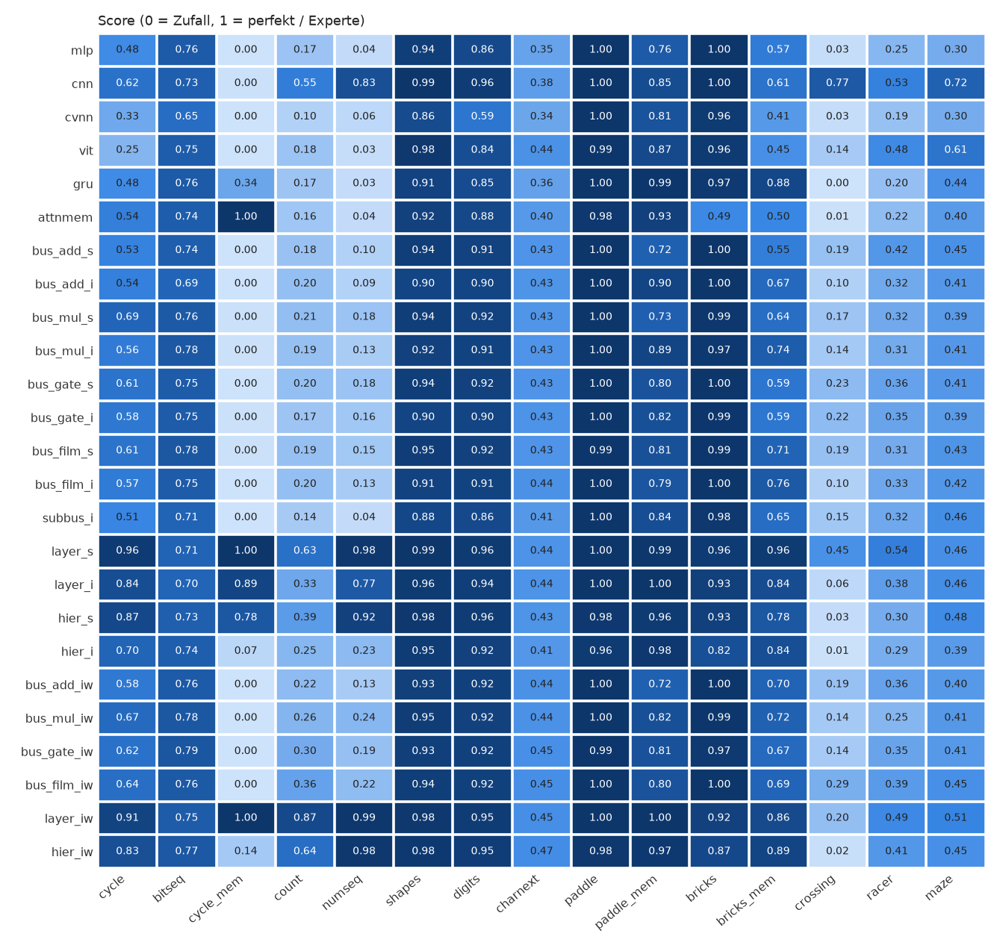

# NetResearch – Benchmark-Report

Läufe: 375 (Seeds [0]), Updates je Lauf: [1500], ~100k Parameter je Modell. Fehlgeschlagene Läufe: 0.

Score: Klassifikation `(acc-chance)/(1-chance)`, Bits: Exact-Match, Spiele `(Return-Random)/(Experte-Random)`. Werte < 0 = schlechter als Zufall.

## Zusammenfassung (Mittel je Task-Gruppe)

| Modell | patterns | image | text | game | gesamt | Ø Rang | Parameter | Trainzeit [min] |
|---|---|---|---|---|---|---|---|---|
| layer_s | 0.86 | 0.98 | 0.44 | 0.76 | 0.80 | 5.53 | 101k | 146.1 |
| layer_iw | 0.90 | 0.97 | 0.45 | 0.71 | 0.79 | 5.70 | 1879k | 201.7 |
| cnn | 0.55 | 0.98 | 0.38 | 0.78 | 0.70 | 8.30 | 103k | 87.9 |
| layer_i | 0.71 | 0.95 | 0.44 | 0.67 | 0.70 | 9.47 | 97k | 53.4 |
| hier_s | 0.74 | 0.97 | 0.43 | 0.64 | 0.70 | 10.27 | 100k | 162.8 |
| hier_iw | 0.67 | 0.96 | 0.47 | 0.66 | 0.69 | 8.20 | 1389k | 214.4 |
| bus_film_iw | 0.40 | 0.93 | 0.45 | 0.66 | 0.59 | 8.83 | 281k | 22.5 |
| bus_mul_iw | 0.39 | 0.94 | 0.44 | 0.62 | 0.57 | 10.80 | 247k | 21.1 |
| hier_i | 0.39 | 0.94 | 0.41 | 0.61 | 0.57 | 14.20 | 100k | 81.0 |
| bus_gate_iw | 0.38 | 0.93 | 0.45 | 0.62 | 0.57 | 12.57 | 281k | 23.6 |
| bus_film_s | 0.35 | 0.93 | 0.43 | 0.63 | 0.57 | 12.43 | 100k | 21.2 |
| bus_gate_s | 0.35 | 0.93 | 0.43 | 0.63 | 0.56 | 12.17 | 100k | 22.7 |
| bus_mul_i | 0.33 | 0.91 | 0.43 | 0.64 | 0.56 | 13.77 | 100k | 15.5 |
| gru | 0.36 | 0.88 | 0.36 | 0.64 | 0.56 | 16.00 | 100k | 16.8 |
| bus_mul_s | 0.37 | 0.93 | 0.43 | 0.61 | 0.56 | 13.33 | 100k | 20.4 |
| bus_add_iw | 0.34 | 0.93 | 0.44 | 0.62 | 0.56 | 13.03 | 247k | 20.2 |
| bus_film_i | 0.33 | 0.91 | 0.44 | 0.63 | 0.55 | 14.23 | 100k | 15.1 |
| bus_gate_i | 0.33 | 0.90 | 0.43 | 0.62 | 0.55 | 14.27 | 100k | 16.1 |
| attnmem | 0.50 | 0.90 | 0.40 | 0.50 | 0.55 | 19.17 | 102k | 54.7 |
| bus_add_i | 0.31 | 0.90 | 0.43 | 0.63 | 0.54 | 15.67 | 100k | 14.7 |
| bus_add_s | 0.31 | 0.93 | 0.43 | 0.62 | 0.54 | 14.77 | 100k | 19.6 |
| vit | 0.24 | 0.91 | 0.44 | 0.64 | 0.53 | 15.80 | 96k | 199.4 |
| subbus_i | 0.28 | 0.87 | 0.41 | 0.63 | 0.53 | 16.63 | 99k | 23.1 |
| mlp | 0.29 | 0.90 | 0.35 | 0.56 | 0.50 | 18.07 | 100k | 10.3 |
| cvnn | 0.23 | 0.72 | 0.34 | 0.53 | 0.44 | 21.80 | 100k | 14.9 |

## Score je Task

| Modell | cycle | bitseq | cycle_mem | count | numseq | shapes | digits | charnext | paddle | paddle_mem | bricks | bricks_mem | crossing | racer | maze |
|---|---|---|---|---|---|---|---|---|---|---|---|---|---|---|---|
| mlp | 0.48 | 0.76 | 0.00 | 0.17 | 0.04 | 0.94 | 0.86 | 0.35 | 1.00 | 0.76 | 1.00 | 0.57 | 0.03 | 0.25 | 0.30 |
| cnn | 0.62 | 0.73 | 0.00 | 0.55 | 0.83 | 0.99 | 0.96 | 0.38 | 1.00 | 0.85 | 1.00 | 0.61 | 0.77 | 0.53 | 0.72 |
| cvnn | 0.33 | 0.65 | 0.00 | 0.10 | 0.06 | 0.86 | 0.59 | 0.34 | 1.00 | 0.81 | 0.96 | 0.41 | 0.03 | 0.19 | 0.30 |
| vit | 0.25 | 0.75 | 0.00 | 0.18 | 0.03 | 0.98 | 0.84 | 0.44 | 0.99 | 0.87 | 0.96 | 0.45 | 0.14 | 0.48 | 0.61 |
| gru | 0.48 | 0.76 | 0.34 | 0.17 | 0.03 | 0.91 | 0.85 | 0.36 | 1.00 | 0.99 | 0.97 | 0.88 | 0.00 | 0.20 | 0.44 |
| attnmem | 0.54 | 0.74 | 1.00 | 0.16 | 0.04 | 0.92 | 0.88 | 0.40 | 0.98 | 0.93 | 0.49 | 0.50 | 0.01 | 0.22 | 0.40 |
| bus_add_s | 0.53 | 0.74 | 0.00 | 0.18 | 0.10 | 0.94 | 0.91 | 0.43 | 1.00 | 0.72 | 1.00 | 0.55 | 0.19 | 0.42 | 0.45 |
| bus_add_i | 0.54 | 0.69 | 0.00 | 0.20 | 0.09 | 0.90 | 0.90 | 0.43 | 1.00 | 0.90 | 1.00 | 0.67 | 0.10 | 0.32 | 0.41 |
| bus_mul_s | 0.69 | 0.76 | 0.00 | 0.21 | 0.18 | 0.94 | 0.92 | 0.43 | 1.00 | 0.73 | 0.99 | 0.64 | 0.17 | 0.32 | 0.39 |
| bus_mul_i | 0.56 | 0.78 | 0.00 | 0.19 | 0.13 | 0.92 | 0.91 | 0.43 | 1.00 | 0.89 | 0.97 | 0.74 | 0.14 | 0.31 | 0.41 |
| bus_gate_s | 0.61 | 0.75 | 0.00 | 0.20 | 0.18 | 0.94 | 0.92 | 0.43 | 1.00 | 0.80 | 1.00 | 0.59 | 0.23 | 0.36 | 0.41 |
| bus_gate_i | 0.58 | 0.75 | 0.00 | 0.17 | 0.16 | 0.90 | 0.90 | 0.43 | 1.00 | 0.82 | 0.99 | 0.59 | 0.22 | 0.35 | 0.39 |
| bus_film_s | 0.61 | 0.78 | 0.00 | 0.19 | 0.15 | 0.95 | 0.92 | 0.43 | 0.99 | 0.81 | 0.99 | 0.71 | 0.19 | 0.31 | 0.43 |
| bus_film_i | 0.57 | 0.75 | 0.00 | 0.20 | 0.13 | 0.91 | 0.91 | 0.44 | 1.00 | 0.79 | 1.00 | 0.76 | 0.10 | 0.33 | 0.42 |
| subbus_i | 0.51 | 0.71 | 0.00 | 0.14 | 0.04 | 0.88 | 0.86 | 0.41 | 1.00 | 0.84 | 0.98 | 0.65 | 0.15 | 0.32 | 0.46 |
| layer_s | 0.96 | 0.71 | 1.00 | 0.63 | 0.98 | 0.99 | 0.96 | 0.44 | 1.00 | 0.99 | 0.96 | 0.96 | 0.45 | 0.54 | 0.46 |
| layer_i | 0.84 | 0.70 | 0.89 | 0.33 | 0.77 | 0.96 | 0.94 | 0.44 | 1.00 | 1.00 | 0.93 | 0.84 | 0.06 | 0.38 | 0.46 |
| hier_s | 0.87 | 0.73 | 0.78 | 0.39 | 0.92 | 0.98 | 0.96 | 0.43 | 0.98 | 0.96 | 0.93 | 0.78 | 0.03 | 0.30 | 0.48 |
| hier_i | 0.70 | 0.74 | 0.07 | 0.25 | 0.23 | 0.95 | 0.92 | 0.41 | 0.96 | 0.98 | 0.82 | 0.84 | 0.01 | 0.29 | 0.39 |
| bus_add_iw | 0.58 | 0.76 | 0.00 | 0.22 | 0.13 | 0.93 | 0.92 | 0.44 | 1.00 | 0.72 | 1.00 | 0.70 | 0.19 | 0.36 | 0.40 |
| bus_mul_iw | 0.67 | 0.78 | 0.00 | 0.26 | 0.24 | 0.95 | 0.92 | 0.44 | 1.00 | 0.82 | 0.99 | 0.72 | 0.14 | 0.25 | 0.41 |
| bus_gate_iw | 0.62 | 0.79 | 0.00 | 0.30 | 0.19 | 0.93 | 0.92 | 0.45 | 0.99 | 0.81 | 0.97 | 0.67 | 0.14 | 0.35 | 0.41 |
| bus_film_iw | 0.64 | 0.76 | 0.00 | 0.36 | 0.22 | 0.94 | 0.92 | 0.45 | 1.00 | 0.80 | 1.00 | 0.69 | 0.29 | 0.39 | 0.45 |
| layer_iw | 0.91 | 0.75 | 1.00 | 0.87 | 0.99 | 0.98 | 0.95 | 0.45 | 1.00 | 1.00 | 0.92 | 0.86 | 0.20 | 0.49 | 0.51 |
| hier_iw | 0.83 | 0.77 | 0.14 | 0.64 | 0.98 | 0.98 | 0.95 | 0.47 | 0.98 | 0.97 | 0.87 | 0.89 | 0.02 | 0.41 | 0.45 |

## Rohmetriken je Task

### cycle

rows = time steps; repeating cycle of 2-8 words (8 bit), 2P..16 rows visible -> next row; test cycles held out

| Modell | acc | score |
|---|---|---|
| mlp | 0.48 | 0.48 |
| cnn | 0.62 | 0.62 |
| cvnn | 0.33 | 0.33 |
| vit | 0.25 | 0.25 |
| gru | 0.48 | 0.48 |
| attnmem | 0.54 | 0.54 |
| bus_add_s | 0.53 | 0.53 |
| bus_add_i | 0.54 | 0.54 |
| bus_mul_s | 0.69 | 0.69 |
| bus_mul_i | 0.56 | 0.56 |
| bus_gate_s | 0.61 | 0.61 |
| bus_gate_i | 0.58 | 0.58 |
| bus_film_s | 0.61 | 0.61 |
| bus_film_i | 0.57 | 0.57 |
| subbus_i | 0.51 | 0.51 |
| layer_s | 0.96 | 0.96 |
| layer_i | 0.84 | 0.84 |
| hier_s | 0.87 | 0.87 |
| hier_i | 0.70 | 0.70 |
| bus_add_iw | 0.58 | 0.58 |
| bus_mul_iw | 0.67 | 0.67 |
| bus_gate_iw | 0.62 | 0.62 |
| bus_film_iw | 0.64 | 0.64 |
| layer_iw | 0.91 | 0.91 |
| hier_iw | 0.83 | 0.83 |

### bitseq

mixed bit-stream generators (periodic, counter, growing runs, xor of cycles, LFSR), 16 bits visible -> next bit; test params held out

| Modell | acc | score |
|---|---|---|
| mlp | 0.88 | 0.76 |
| cnn | 0.86 | 0.73 |
| cvnn | 0.82 | 0.65 |
| vit | 0.87 | 0.75 |
| gru | 0.88 | 0.76 |
| attnmem | 0.87 | 0.74 |
| bus_add_s | 0.87 | 0.74 |
| bus_add_i | 0.85 | 0.69 |
| bus_mul_s | 0.88 | 0.76 |
| bus_mul_i | 0.89 | 0.78 |
| bus_gate_s | 0.87 | 0.75 |
| bus_gate_i | 0.88 | 0.75 |
| bus_film_s | 0.89 | 0.78 |
| bus_film_i | 0.87 | 0.75 |
| subbus_i | 0.85 | 0.71 |
| layer_s | 0.86 | 0.71 |
| layer_i | 0.85 | 0.70 |
| hier_s | 0.87 | 0.73 |
| hier_i | 0.87 | 0.74 |
| bus_add_iw | 0.88 | 0.76 |
| bus_mul_iw | 0.89 | 0.78 |
| bus_gate_iw | 0.89 | 0.79 |
| bus_film_iw | 0.88 | 0.76 |
| layer_iw | 0.88 | 0.75 |
| hier_iw | 0.89 | 0.77 |

### cycle_mem

repeating cycle of 2-8 words, only the current row visible -> next row (needs memory)

| Modell | acc | score |
|---|---|---|
| mlp | 0.00 | 0.00 |
| cnn | 0.00 | 0.00 |
| cvnn | 0.00 | 0.00 |
| vit | 0.00 | 0.00 |
| gru | 0.34 | 0.34 |
| attnmem | 1.00 | 1.00 |
| bus_add_s | 0.00 | 0.00 |
| bus_add_i | 0.00 | 0.00 |
| bus_mul_s | 0.00 | 0.00 |
| bus_mul_i | 0.00 | 0.00 |
| bus_gate_s | 0.00 | 0.00 |
| bus_gate_i | 0.00 | 0.00 |
| bus_film_s | 0.00 | 0.00 |
| bus_film_i | 0.00 | 0.00 |
| subbus_i | 0.00 | 0.00 |
| layer_s | 1.00 | 1.00 |
| layer_i | 0.89 | 0.89 |
| hier_s | 0.78 | 0.78 |
| hier_i | 0.07 | 0.07 |
| bus_add_iw | 0.00 | 0.00 |
| bus_mul_iw | 0.00 | 0.00 |
| bus_gate_iw | 0.00 | 0.00 |
| bus_film_iw | 0.00 | 0.00 |
| layer_iw | 1.00 | 1.00 |
| hier_iw | 0.14 | 0.14 |

### count

rows = v0, v0+k, ... (random start, step 1-15, mod 256), 2-16 rows visible -> next

| Modell | acc | score |
|---|---|---|
| mlp | 0.17 | 0.17 |
| cnn | 0.55 | 0.55 |
| cvnn | 0.10 | 0.10 |
| vit | 0.18 | 0.18 |
| gru | 0.17 | 0.17 |
| attnmem | 0.16 | 0.16 |
| bus_add_s | 0.18 | 0.18 |
| bus_add_i | 0.20 | 0.20 |
| bus_mul_s | 0.21 | 0.21 |
| bus_mul_i | 0.19 | 0.19 |
| bus_gate_s | 0.20 | 0.20 |
| bus_gate_i | 0.17 | 0.17 |
| bus_film_s | 0.19 | 0.19 |
| bus_film_i | 0.20 | 0.20 |
| subbus_i | 0.14 | 0.14 |
| layer_s | 0.63 | 0.63 |
| layer_i | 0.33 | 0.33 |
| hier_s | 0.39 | 0.39 |
| hier_i | 0.25 | 0.25 |
| bus_add_iw | 0.22 | 0.22 |
| bus_mul_iw | 0.26 | 0.26 |
| bus_gate_iw | 0.30 | 0.30 |
| bus_film_iw | 0.36 | 0.36 |
| layer_iw | 0.87 | 0.87 |
| hier_iw | 0.64 | 0.64 |

### numseq

3 rows, rule arithmetic (k=1..63) or fibonacci-like -> next number

| Modell | acc | score |
|---|---|---|
| mlp | 0.04 | 0.04 |
| cnn | 0.83 | 0.83 |
| cvnn | 0.06 | 0.06 |
| vit | 0.03 | 0.03 |
| gru | 0.03 | 0.03 |
| attnmem | 0.04 | 0.04 |
| bus_add_s | 0.10 | 0.10 |
| bus_add_i | 0.09 | 0.09 |
| bus_mul_s | 0.18 | 0.18 |
| bus_mul_i | 0.13 | 0.13 |
| bus_gate_s | 0.18 | 0.18 |
| bus_gate_i | 0.16 | 0.16 |
| bus_film_s | 0.15 | 0.15 |
| bus_film_i | 0.13 | 0.13 |
| subbus_i | 0.04 | 0.04 |
| layer_s | 0.98 | 0.98 |
| layer_i | 0.77 | 0.77 |
| hier_s | 0.92 | 0.92 |
| hier_i | 0.23 | 0.23 |
| bus_add_iw | 0.13 | 0.13 |
| bus_mul_iw | 0.24 | 0.24 |
| bus_gate_iw | 0.19 | 0.19 |
| bus_film_iw | 0.22 | 0.22 |
| layer_iw | 0.99 | 0.99 |
| hier_iw | 0.98 | 0.98 |

### shapes

6 geometric shapes, random size/pos/colour, 2% pixel noise

| Modell | acc | score |
|---|---|---|
| mlp | 0.95 | 0.94 |
| cnn | 1.00 | 0.99 |
| cvnn | 0.88 | 0.86 |
| vit | 0.98 | 0.98 |
| gru | 0.93 | 0.91 |
| attnmem | 0.93 | 0.92 |
| bus_add_s | 0.95 | 0.94 |
| bus_add_i | 0.92 | 0.90 |
| bus_mul_s | 0.95 | 0.94 |
| bus_mul_i | 0.93 | 0.92 |
| bus_gate_s | 0.95 | 0.94 |
| bus_gate_i | 0.92 | 0.90 |
| bus_film_s | 0.96 | 0.95 |
| bus_film_i | 0.93 | 0.91 |
| subbus_i | 0.90 | 0.88 |
| layer_s | 1.00 | 0.99 |
| layer_i | 0.97 | 0.96 |
| hier_s | 0.99 | 0.98 |
| hier_i | 0.96 | 0.95 |
| bus_add_iw | 0.94 | 0.93 |
| bus_mul_iw | 0.96 | 0.95 |
| bus_gate_iw | 0.94 | 0.93 |
| bus_film_iw | 0.95 | 0.94 |
| layer_iw | 0.98 | 0.98 |
| hier_iw | 0.98 | 0.98 |

### digits

digit OCR from system fonts; test fonts held out

| Modell | acc | score |
|---|---|---|
| mlp | 0.88 | 0.86 |
| cnn | 0.96 | 0.96 |
| cvnn | 0.63 | 0.59 |
| vit | 0.85 | 0.84 |
| gru | 0.87 | 0.85 |
| attnmem | 0.89 | 0.88 |
| bus_add_s | 0.92 | 0.91 |
| bus_add_i | 0.91 | 0.90 |
| bus_mul_s | 0.92 | 0.92 |
| bus_mul_i | 0.92 | 0.91 |
| bus_gate_s | 0.93 | 0.92 |
| bus_gate_i | 0.91 | 0.90 |
| bus_film_s | 0.93 | 0.92 |
| bus_film_i | 0.92 | 0.91 |
| subbus_i | 0.88 | 0.86 |
| layer_s | 0.97 | 0.96 |
| layer_i | 0.95 | 0.94 |
| hier_s | 0.96 | 0.96 |
| hier_i | 0.93 | 0.92 |
| bus_add_iw | 0.93 | 0.92 |
| bus_mul_iw | 0.93 | 0.92 |
| bus_gate_iw | 0.93 | 0.92 |
| bus_film_iw | 0.93 | 0.92 |
| layer_iw | 0.96 | 0.95 |
| hier_iw | 0.95 | 0.95 |

### charnext

next char; last 16 chars as one-hot rows (col=i%16, ch=i//16)

| Modell | acc | bpc | score |
|---|---|---|---|
| mlp | 0.47 | 2.61 | 0.35 |
| cnn | 0.49 | 2.51 | 0.38 |
| cvnn | 0.46 | 2.71 | 0.34 |
| vit | 0.54 | 2.25 | 0.44 |
| gru | 0.48 | 2.57 | 0.36 |
| attnmem | 0.51 | 2.39 | 0.40 |
| bus_add_s | 0.53 | 2.34 | 0.43 |
| bus_add_i | 0.54 | 2.30 | 0.43 |
| bus_mul_s | 0.53 | 2.35 | 0.43 |
| bus_mul_i | 0.53 | 2.36 | 0.43 |
| bus_gate_s | 0.53 | 2.32 | 0.43 |
| bus_gate_i | 0.54 | 2.29 | 0.43 |
| bus_film_s | 0.54 | 2.30 | 0.43 |
| bus_film_i | 0.54 | 2.29 | 0.44 |
| subbus_i | 0.52 | 2.36 | 0.41 |
| layer_s | 0.54 | 2.30 | 0.44 |
| layer_i | 0.54 | 2.27 | 0.44 |
| hier_s | 0.54 | 2.30 | 0.43 |
| hier_i | 0.52 | 2.36 | 0.41 |
| bus_add_iw | 0.54 | 2.28 | 0.44 |
| bus_mul_iw | 0.55 | 2.34 | 0.44 |
| bus_gate_iw | 0.55 | 2.28 | 0.45 |
| bus_film_iw | 0.56 | 2.27 | 0.45 |
| layer_iw | 0.56 | 2.32 | 0.45 |
| hier_iw | 0.57 | 2.17 | 0.47 |

### paddle (Random: -2.03, Experte: 4.88)

paddle duel vs CPU, first to 5 points

| Modell | return | ep_len | score |
|---|---|---|---|
| mlp | 4.88 | 110.88 | 1.00 |
| cnn | 4.88 | 110.88 | 1.00 |
| cvnn | 4.88 | 110.88 | 1.00 |
| vit | 4.81 | 113.00 | 0.99 |
| gru | 4.88 | 110.88 | 1.00 |
| attnmem | 4.72 | 104.81 | 0.98 |
| bus_add_s | 4.88 | 110.88 | 1.00 |
| bus_add_i | 4.88 | 110.88 | 1.00 |
| bus_mul_s | 4.88 | 110.88 | 1.00 |
| bus_mul_i | 4.88 | 110.88 | 1.00 |
| bus_gate_s | 4.88 | 110.88 | 1.00 |
| bus_gate_i | 4.88 | 110.88 | 1.00 |
| bus_film_s | 4.81 | 112.19 | 0.99 |
| bus_film_i | 4.88 | 110.88 | 1.00 |
| subbus_i | 4.88 | 110.88 | 1.00 |
| layer_s | 4.88 | 110.88 | 1.00 |
| layer_i | 4.84 | 108.69 | 1.00 |
| hier_s | 4.72 | 110.72 | 0.98 |
| hier_i | 4.62 | 112.88 | 0.96 |
| bus_add_iw | 4.88 | 110.88 | 1.00 |
| bus_mul_iw | 4.88 | 110.88 | 1.00 |
| bus_gate_iw | 4.81 | 111.38 | 0.99 |
| bus_film_iw | 4.88 | 110.88 | 1.00 |
| layer_iw | 4.84 | 109.50 | 1.00 |
| hier_iw | 4.75 | 111.88 | 0.98 |

### paddle_mem (Random: -2.03, Experte: 4.88)

paddle duel without ball trail (needs memory)

| Modell | return | ep_len | score |
|---|---|---|---|
| mlp | 3.22 | 105.81 | 0.76 |
| cnn | 3.84 | 102.00 | 0.85 |
| cvnn | 3.53 | 97.16 | 0.81 |
| vit | 3.97 | 105.12 | 0.87 |
| gru | 4.81 | 113.81 | 0.99 |
| attnmem | 4.38 | 103.03 | 0.93 |
| bus_add_s | 2.97 | 104.72 | 0.72 |
| bus_add_i | 4.19 | 109.88 | 0.90 |
| bus_mul_s | 3.00 | 110.34 | 0.73 |
| bus_mul_i | 4.12 | 114.44 | 0.89 |
| bus_gate_s | 3.50 | 111.47 | 0.80 |
| bus_gate_i | 3.66 | 115.09 | 0.82 |
| bus_film_s | 3.59 | 100.16 | 0.81 |
| bus_film_i | 3.44 | 106.72 | 0.79 |
| subbus_i | 3.78 | 103.41 | 0.84 |
| layer_s | 4.78 | 107.56 | 0.99 |
| layer_i | 4.84 | 109.50 | 1.00 |
| hier_s | 4.62 | 107.41 | 0.96 |
| hier_i | 4.72 | 111.31 | 0.98 |
| bus_add_iw | 2.97 | 104.59 | 0.72 |
| bus_mul_iw | 3.66 | 108.00 | 0.82 |
| bus_gate_iw | 3.56 | 111.28 | 0.81 |
| bus_film_iw | 3.50 | 104.59 | 0.80 |
| layer_iw | 4.84 | 111.94 | 1.00 |
| hier_iw | 4.69 | 111.78 | 0.97 |

### bricks (Random: 0.62, Experte: 51.22)

clear 64 bricks, 3 lives

| Modell | return | ep_len | score |
|---|---|---|---|
| mlp | 51.47 | 600.00 | 1.00 |
| cnn | 51.12 | 598.53 | 1.00 |
| cvnn | 49.34 | 570.16 | 0.96 |
| vit | 49.38 | 581.72 | 0.96 |
| gru | 49.72 | 580.31 | 0.97 |
| attnmem | 25.38 | 411.19 | 0.49 |
| bus_add_s | 51.22 | 600.00 | 1.00 |
| bus_add_i | 51.22 | 600.00 | 1.00 |
| bus_mul_s | 50.53 | 600.00 | 0.99 |
| bus_mul_i | 49.84 | 597.84 | 0.97 |
| bus_gate_s | 51.38 | 596.03 | 1.00 |
| bus_gate_i | 50.66 | 600.00 | 0.99 |
| bus_film_s | 50.81 | 592.09 | 0.99 |
| bus_film_i | 51.09 | 600.00 | 1.00 |
| subbus_i | 50.31 | 596.66 | 0.98 |
| layer_s | 49.19 | 573.31 | 0.96 |
| layer_i | 47.78 | 561.16 | 0.93 |
| hier_s | 47.53 | 574.78 | 0.93 |
| hier_i | 42.22 | 499.62 | 0.82 |
| bus_add_iw | 51.22 | 600.00 | 1.00 |
| bus_mul_iw | 50.69 | 600.00 | 0.99 |
| bus_gate_iw | 49.72 | 581.72 | 0.97 |
| bus_film_iw | 51.34 | 596.03 | 1.00 |
| layer_iw | 47.19 | 544.44 | 0.92 |
| hier_iw | 44.81 | 526.12 | 0.87 |

### bricks_mem (Random: 0.62, Experte: 51.22)

bricks without ball trail (needs memory)

| Modell | return | ep_len | score |
|---|---|---|---|
| mlp | 29.31 | 432.09 | 0.57 |
| cnn | 31.59 | 427.00 | 0.61 |
| cvnn | 21.16 | 354.50 | 0.41 |
| vit | 23.41 | 334.31 | 0.45 |
| gru | 45.28 | 536.75 | 0.88 |
| attnmem | 25.75 | 354.56 | 0.50 |
| bus_add_s | 28.44 | 373.62 | 0.55 |
| bus_add_i | 34.56 | 435.38 | 0.67 |
| bus_mul_s | 33.19 | 414.75 | 0.64 |
| bus_mul_i | 38.25 | 488.50 | 0.74 |
| bus_gate_s | 30.66 | 378.50 | 0.59 |
| bus_gate_i | 30.28 | 427.34 | 0.59 |
| bus_film_s | 36.44 | 478.22 | 0.71 |
| bus_film_i | 39.28 | 508.00 | 0.76 |
| subbus_i | 33.31 | 436.69 | 0.65 |
| layer_s | 49.25 | 594.19 | 0.96 |
| layer_i | 43.34 | 519.56 | 0.84 |
| hier_s | 40.09 | 485.19 | 0.78 |
| hier_i | 42.88 | 511.28 | 0.84 |
| bus_add_iw | 36.28 | 455.47 | 0.70 |
| bus_mul_iw | 36.91 | 445.19 | 0.72 |
| bus_gate_iw | 34.41 | 449.91 | 0.67 |
| bus_film_iw | 35.66 | 472.81 | 0.69 |
| layer_iw | 44.12 | 525.88 | 0.86 |
| hier_iw | 45.84 | 552.28 | 0.89 |

### crossing (Random: -1.00, Experte: 11.22)

cross 10 traffic lanes, +1 per crossing

| Modell | return | ep_len | score |
|---|---|---|---|
| mlp | -0.66 | 22.81 | 0.03 |
| cnn | 8.38 | 232.19 | 0.77 |
| cvnn | -0.66 | 21.47 | 0.03 |
| vit | 0.69 | 55.66 | 0.14 |
| gru | -0.97 | 13.28 | 0.00 |
| attnmem | -0.91 | 18.06 | 0.01 |
| bus_add_s | 1.31 | 64.19 | 0.19 |
| bus_add_i | 0.25 | 46.62 | 0.10 |
| bus_mul_s | 1.06 | 55.12 | 0.17 |
| bus_mul_i | 0.72 | 55.47 | 0.14 |
| bus_gate_s | 1.78 | 83.25 | 0.23 |
| bus_gate_i | 1.69 | 81.00 | 0.22 |
| bus_film_s | 1.38 | 64.06 | 0.19 |
| bus_film_i | 0.22 | 46.31 | 0.10 |
| subbus_i | 0.88 | 55.88 | 0.15 |
| layer_s | 4.47 | 146.69 | 0.45 |
| layer_i | -0.31 | 24.78 | 0.06 |
| hier_s | -0.59 | 26.75 | 0.03 |
| hier_i | -0.94 | 14.81 | 0.01 |
| bus_add_iw | 1.28 | 71.62 | 0.19 |
| bus_mul_iw | 0.75 | 56.66 | 0.14 |
| bus_gate_iw | 0.69 | 54.81 | 0.14 |
| bus_film_iw | 2.50 | 99.66 | 0.29 |
| layer_iw | 1.50 | 73.00 | 0.20 |
| hier_iw | -0.78 | 21.75 | 0.02 |

### racer (Random: 19.66, Experte: 280.91)

dodge obstacles, +1 per step survived

| Modell | return | ep_len | score |
|---|---|---|---|
| mlp | 83.78 | 84.75 | 0.25 |
| cnn | 158.31 | 159.16 | 0.53 |
| cvnn | 68.81 | 69.81 | 0.19 |
| vit | 145.47 | 146.34 | 0.48 |
| gru | 70.97 | 71.97 | 0.20 |
| attnmem | 76.00 | 77.00 | 0.22 |
| bus_add_s | 128.31 | 129.22 | 0.42 |
| bus_add_i | 103.75 | 104.72 | 0.32 |
| bus_mul_s | 103.03 | 103.97 | 0.32 |
| bus_mul_i | 100.91 | 101.91 | 0.31 |
| bus_gate_s | 112.56 | 113.53 | 0.36 |
| bus_gate_i | 110.47 | 111.41 | 0.35 |
| bus_film_s | 99.81 | 100.78 | 0.31 |
| bus_film_i | 105.41 | 106.38 | 0.33 |
| subbus_i | 104.44 | 105.41 | 0.32 |
| layer_s | 161.44 | 162.25 | 0.54 |
| layer_i | 118.97 | 119.94 | 0.38 |
| hier_s | 99.00 | 99.97 | 0.30 |
| hier_i | 96.12 | 97.06 | 0.29 |
| bus_add_iw | 112.56 | 113.47 | 0.36 |
| bus_mul_iw | 84.66 | 85.66 | 0.25 |
| bus_gate_iw | 110.34 | 111.31 | 0.35 |
| bus_film_iw | 122.66 | 123.56 | 0.39 |
| layer_iw | 147.06 | 147.94 | 0.49 |
| hier_iw | 127.97 | 128.84 | 0.41 |

### maze (Random: -0.81, Experte: 36.72)

collect pellets, avoid 2 chasers

| Modell | return | ep_len | score |
|---|---|---|---|
| mlp | 10.59 | 31.72 | 0.30 |
| cnn | 26.03 | 49.72 | 0.72 |
| cvnn | 10.59 | 31.66 | 0.30 |
| vit | 21.94 | 45.28 | 0.61 |
| gru | 15.78 | 34.75 | 0.44 |
| attnmem | 14.12 | 32.97 | 0.40 |
| bus_add_s | 15.94 | 37.97 | 0.45 |
| bus_add_i | 14.62 | 34.97 | 0.41 |
| bus_mul_s | 13.88 | 33.94 | 0.39 |
| bus_mul_i | 14.69 | 33.88 | 0.41 |
| bus_gate_s | 14.66 | 34.91 | 0.41 |
| bus_gate_i | 13.84 | 33.88 | 0.39 |
| bus_film_s | 15.41 | 35.22 | 0.43 |
| bus_film_i | 14.97 | 35.00 | 0.42 |
| subbus_i | 16.56 | 38.06 | 0.46 |
| layer_s | 16.31 | 35.00 | 0.46 |
| layer_i | 16.34 | 35.09 | 0.46 |
| hier_s | 17.09 | 37.16 | 0.48 |
| hier_i | 14.00 | 33.31 | 0.39 |
| bus_add_iw | 14.34 | 33.56 | 0.40 |
| bus_mul_iw | 14.50 | 34.56 | 0.41 |
| bus_gate_iw | 14.41 | 34.88 | 0.41 |
| bus_film_iw | 16.09 | 36.62 | 0.45 |
| layer_iw | 18.28 | 39.00 | 0.51 |
| hier_iw | 16.19 | 37.25 | 0.45 |
